# 第一章：数字系统设计导论

## 1.1 数字系统的形成

数字系统（digital system）是以数字逻辑（digital logic）为基础、用离散符号表示和处理信息的系统。现代数字系统的发展建立在布尔代数（Boolean algebra）、电子器件与集成电路（integrated circuit, IC）三个基础上。

| 时期            | 课件给出的代表性事件                        |
| ------------- | --------------------------------- |
| 1642 年        | Pascal 制成机械加法器。                   |
| 1671 年        | Leibniz 制成可进行乘、除运算的机械计算器。         |
| 1854 年        | Boole 提出布尔代数。                     |
| 1944 年        | EDVAC 的设计采用二进制数制。                 |
| 1904 年、1947 年 | 真空三极管和晶体管相继出现。                    |
| 1960 年后       | 集成电路、微处理器、大规模与超大规模集成电路推动数字系统快速发展。 |

## 1.2 模拟量（analog quantity）与数字量（digital quantity）

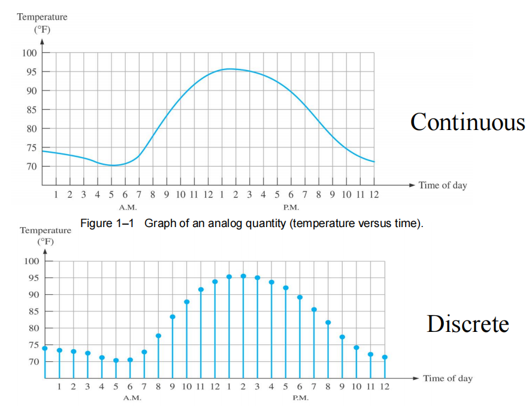
- <mark>🔴模拟量与数字量</mark>
	- <mark>模拟量</mark>用连续变化的物理量表示信息，例如温度、压力、时间、速度和声音。
	- <mark>数字量</mark>由有限个离散取值表示信息；二进制数字系统通常只区分 0 和 1。
	- 转换链为<mark>采样 → 量化 → 编码</mark>；量化会带来有限分辨率。

数字化并不意味着所有物理量均能精确表示。例如数值 \\(1/3\\) 的二进制小数是无限循环的，有限位存储时仍须近似。

- <mark>🔴数字化的优势</mark>
	- <mark>图像质量</mark>由每个像素的位数和图像中的像素数共同决定。
	- <mark>数字音频</mark>由数字存储/处理、数模转换器和扬声器等模拟输出部分共同构成。
	- <mark>数字存储</mark>只需可靠地区分 0 和 1；复制时可再生相同代码，较少累积失真。
	- <mark>数字处理</mark>可在可预测的精度下完成复杂运算，且数字信号抗噪声能力较强。

## 1.3 二进制位、逻辑电平（logic level）与数字波形（digital waveform）

- <mark>🔴比特与逻辑约定</mark>
	- <mark>比特（bit）</mark>是二进制数字系统的信息基本单位。
	- <mark>正逻辑</mark>规定高电平表示 1、低电平表示 0；<mark>负逻辑</mark>的对应关系相反。
	- 多个比特组成的<mark>比特组</mark>可按约定表示数值、字符或其他代码。

| 数制 | 基数 | 数码 | 课件示例 |
| --- | --- | --- | --- |
| 十进制 | 10 | 0–9 | \\((1032)_{10}\\) |
| 二进制 | 2 | 0、1 | \\((1011)_2=(11)_{10}\\) |
| 十六进制 | 16 | 0–9、A–F | \\((2A5)_{16}=(677)_{10}\\) |

- <mark>🔴逻辑电平的判定</mark>
	- 以 5 V CMOS 逻辑为例：<mark>\\(0\sim0.8\\) V</mark> 属于可识别的低电平，<mark>\\(2\sim3.3\\) V</mark> 属于可识别的高电平。
	- 二者之间为<mark>不允许的输入范围</mark>，因此逻辑 0/1 不是简单的“有电/无电”。

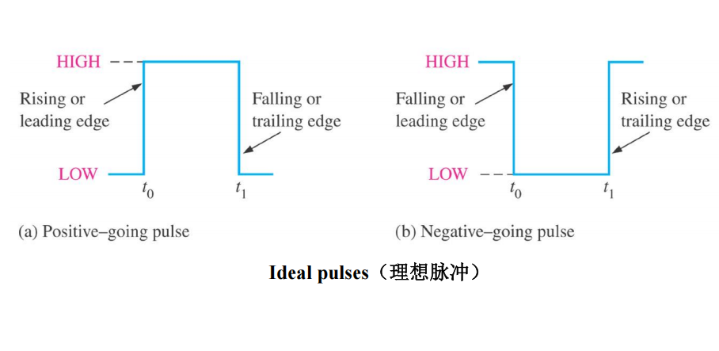
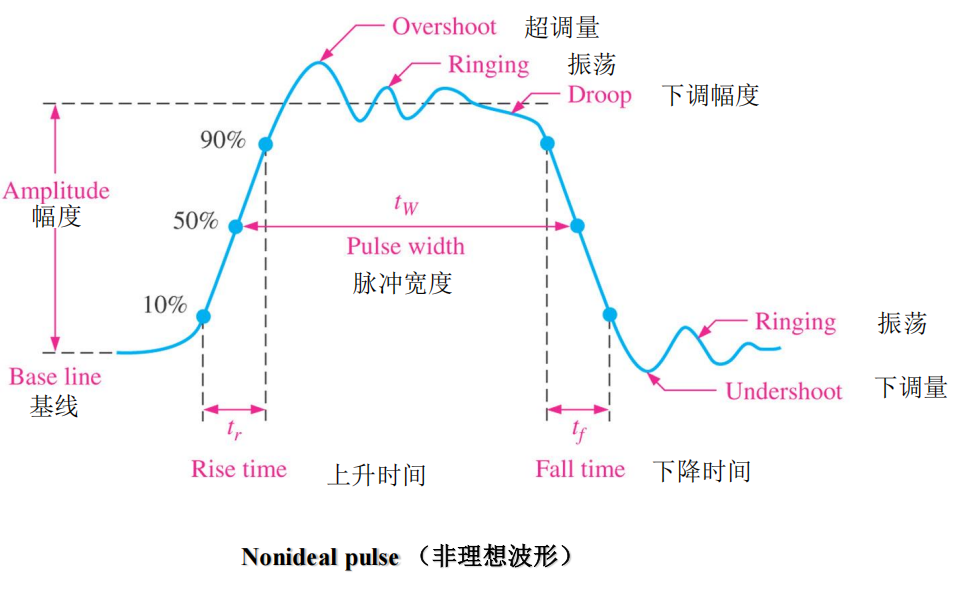
- <mark>🔴数字波形的必记参数</mark>
	- <mark>周期与频率</mark>满足 \\(f=1/T\\)。
	- <mark>占空比</mark>为 \\(D=100\%\,t_w/T\\)，其中 \\(t_w\\) 为脉冲宽度。
	- 实际波形还要关注<mark>幅度、基线、上升/下降时间、过冲、下冲与振铃</mark>。

## 1.4 数字系统的基本功能模块

- <mark>🔴基本功能模块</mark>
	- <mark>逻辑运算</mark>：非门、与门、或门实现基本逻辑运算。
	- <mark>运算与比较</mark>：比较器比较二进制数大小；加法器完成二进制加法。
	- <mark>代码转换</mark>：编码器与译码器在不同代码形式之间转换。
	- <mark>时序与存储</mark>：计数器按时钟脉冲计数；存储器保存二进制信息。
	- <mark>数据选择</mark>：多路选择器从多路输入中选择一路送往输出。

## 1.5 集成电路、可编程器件与常用仪器

- <mark>🔴固定功能与可编程器件</mark>
	- <mark>固定功能 IC</mark>的功能在制造时确定，用户不能改变内部逻辑连接。
	- <mark>可编程逻辑器件（PLD）</mark>允许用户按设计要求配置内部逻辑；课件列举 SPLD、CPLD 与 FPGA。
	- <mark>集成规模</mark>按等效门数粗略划分：SSI 少于 10，MSI 为 10–100，LSI 为 100–10 000，VLSI 为 10 000–100 000，ULSI 超过 1 000 000。

| 逻辑系列 | 主要器件基础 |
| --- | --- |
| CMOS（Complementary Metal-Oxide-Semiconductor） | 金属氧化物半导体场效应管（metal-oxide-semiconductor field-effect transistor, MOSFET） |
| TTL（Transistor-Transistor Logic） | 双极型结型晶体管（bipolar junction transistor, BJT） |
| BiCMOS（Bipolar CMOS） | CMOS 与双极型器件结合 |

常见封装包括 SIP、DIP、SOIC、PLCC、LCCC、SSOP、TSSOP、TVSOP 与 BGA。芯片的缺口、圆点或斜边等标记用于定位 1 脚。

- <mark>🔴常用实验仪器</mark>
	- <mark>直流电源</mark>提供稳定供电；<mark>信号发生器</mark>产生测试用时钟或波形。
	- <mark>示波器</mark>观察电压随时间变化的波形；<mark>数字万用表</mark>测量电压、电流、电阻等基本量。

# 第二章：数制、运算与代码
## 2.1 位置计数制（positional number system）

- <mark>🔴位置计数制的规则</mark>
	- 一个数码的数值由<mark>数码本身</mark>及其所在位置的<mark>权值</mark>共同决定。
	- 基数为 \\(r\\) 的数制中，各位权值为<mark>\\(r^i\\)</mark>；数制的基数用下标标明。
	- 二进制的基数为 <mark>2</mark>；十六进制的基数为 <mark>16</mark>，数码 A–F 对应十进制 10–15。

## 2.2 二进制（binary）、十进制（decimal）与十六进制（hexadecimal）转换

- <mark>🔴数制转换的方向口诀</mark>
	- 二进制转十进制：<mark>按位权展开求和</mark>。
	- 十进制整数转二进制：<mark>连续除以 2，倒取余数</mark>。
	- 十进制小数转二进制：<mark>连续乘以 2，顺取整数部分</mark>。
	- 二进制与十六进制互转：从小数点向两侧<mark>每 4 位分组</mark>。

**[ 例题 ] 二进制小数转十进制**
将 \\((101011.11)_2\\) 转换为十进制数。

> 解
> 1. 整数部分为 \\(1\times2^5+1\times2^3+1\times2+1=43\\)。
> 2. 小数部分为 \\(1\times2^{-1}+1\times2^{-2}=0.75\\)。
> 3. 因此 \\((101011.11)_2=(43.75)_{10}\\)。

**[ 例题 ] 十进制数转二进制**
将 \\((173.8125)_{10}\\) 转换为二进制数。

> 解
> 1. 整数部分连续除以 2：\\(173\div2\\) 的余数依次为 \\(1,0,1,1,0,1,0,1\\)，倒取后为 \\(10101101_2\\)
> 2. 小数部分连续乘以 2：\\(0.8125\times2=1.625\\)，\\(0.625\times2=1.25\\)，\\(0.25\times2=0.5\\)，\\(0.5\times2=1.0\\)，顺取整数部分为 \\(.1101_2\\)
> 3. 因此 \\((173.8125)_{10}=(10101101.1101)_2\\)

**[ 例题 ] 二进制与十六进制互换**
将 \\((0101111010110010)_2\\) 化为十六进制，并将 \\((8FAC6)_{16}\\) 化为二进制。

> 解
> 1. 前者每 4 位分组为 \\(0101\ 1110\ 1011\ 0010\\)，对应 \\((5EB2)_{16}\\)
> 2. 后者逐个十六进制数码展开：\\(8\to1000\\)，\\(F\to1111\\)，\\(A\to1010\\)，\\(C\to1100\\)，\\(6\to0110\\)
> 3. 因此 \\((8FAC6)_{16}=(10001111101011000110)_2\\)

## 2.3 无符号（unsigned）二进制运算

- <mark>🔴无符号运算与位宽</mark>
	- 二进制加法遵循 \\(0+0=0\\)、\\(0+1=1\\)、\\(1+0=1\\)、\\(1+1=10\\)。
	- 两个 \\(k\\) 位无符号数相加，完整结果最多需要 <mark>\\(k+1\\) 位</mark>；若丢弃最高进位会发生<mark>回绕</mark>。
	- 二进制减法、乘法和除法分别对应十进制的<mark>借位、部分积和长除法</mark>过程。

**[ 例题 ] 无符号加法的位宽**
用 6 位二进制数计算 \\(45+44\\)，并说明结果的位数。
> 解
> 1. \\((45)_{10}=(101101)_2\\)，\\((44)_{10}=(101100)_2\\)。
> 2. 相加得 \\(101101+101100=1011001_2\\)。
> 3. \\((1011001)_2=(89)_{10}\\)，结果需要 7 位，正是两个 6 位数相加的最高可能位数。

**[ 例题 ] 位宽不足时的回绕**
在仅有 4 位的无符号寄存器中计算 \\(15+1\\)。
> 解
> 1. \\((15)_{10}=1111_2\\)，\\((1)_{10}=0001_2\\)。
> 2. 完整和为 \\(10000_2\\)。
> 3. 若寄存器只保留低 4 位，存储结果为 \\(0000_2\\)；被丢弃的最终进位表明位宽不足。

**[ 例题 ] 二进制减法与乘法**
分别计算 \\((101)_2-(011)_2\\) 与 \\((101)_2\times(111)_2\\)。
> 解
> 1. 减法按位借位：\\(101_2-011_2=010_2\\)。
> 2. 乘法的被乘数依次左移并按乘数位相加：\\(101_2\times111_2=100011_2\\)。
> 3. 十进制核对：\\(5-3=2\\)，\\(5\times7=35\\)，与二进制结果一致。

- <mark>🔴反码与补码的构造</mark>
	- <mark>反码</mark>：各位 0、1 互换，例如 \\(11001010\to00110101\\)。
	- <mark>补码</mark>：反码加 1，例如 \\(11001010\\) 的补码为 \\(00110110\\)。

## 2.4 有符号（signed）二进制数

### 2.4.1 原码（sign-magnitude representation）

- <mark>🔴原码的优缺点</mark>
	- 最高位是<mark>符号位</mark>：0 表示正，1 表示负；其余位表示绝对值。
	- 原码有 <mark>\\(+0\\) 与 \\(-0\\)</mark> 两种零表示。
	- 同号数可直接相加绝对值；异号数需比较绝对值并相减，<mark>硬件处理不统一</mark>。

**[ 例题 ] 5 位原码的加法**
用 5 位原码计算 \\(+3+(+4)\\)、\\(-3+(-4)\\)、\\(+5+(-3)\\) 和 \\(+2+(-5)\\)。
> 解
> 1. \\(+3+(+4)=+7\\)，两个正数的绝对值相加。
> 2. \\(-3+(-4)=-7\\)，两个负数的绝对值相加并保留负号。
> 3. \\(+5+(-3)=+2\\)，异号时做 \\(5-3\\)，符号取绝对值较大的加数的符号。
> 4. \\(+2+(-5)=-3\\)，异号时做 \\(5-2\\)，符号为负。

### 2.4.2 反码（one's complement）

- <mark>🔴反码的优缺点</mark>
	- 正数反码与原码相同；负数保留符号位、其余数值位取反。
	- 加法可共用一个加法器，但产生最高位进位时必须做<mark>循环进位相加</mark>。
	- 反码仍有<mark>\\(+0\\) 与 \\(-0\\)</mark>两种零表示。

**[ 例题 ] 反码中的异号相加**
用 4 位反码计算 \\(+5+(-3)\\)。
> 解
> 1. \\(+5\\) 的反码为 \\(0101\\)；\\(-3\\) 的原码为 \\(1011\\)，反码为 \\(1100\\)。
> 2. 相加得 \\(0101+1100=10001\\)。
> 3. 将最高位进位 1 循环加到低位：\\(0001+1=0010\\)。
> 4. \\(0010\\) 表示 \\(+2\\)，故结果为 \\(+2\\)。

### 2.4.3 补码（two's complement）

- <mark>🔴补码：统一加减法</mark>
	- 正数补码与原码相同；
	- 负数补码为<mark>反码加 1</mark>。（或写为整数的补码全部取反+1）
	- \\(k\\) 位补码的最高位权值为 <mark>\\(-2^{k-1}\\)</mark>，其余各位权值仍为正的 \\(2^i\\)。
	- <mark>符号扩展</mark>：正数左侧补 0，负数左侧补 1。
	- **求相反数**为<mark>全部位取反后加 1</mark>；加法位操作与无符号加法相同，最终进位丢弃。
	- \\(n\\) 位补码的范围为 <mark>\\(-2^{n-1}\sim2^{n-1}-1\\)</mark>；8 位范围为 <mark>\\(-128\sim127\\)</mark>。

**[ 例题 ] 8 位负数的补码**
写出 \\(-25\\) 和 \\(-39\\) 的 8 位补码。
> 解
> 1. \\(+25=00011001_2\\)，按位取反得 \\(11100110_2\\)，加 1 得 \\(-25=11100111_2\\)。
> 2. \\(+39=00100111_2\\)，按位取反得 \\(11011000_2\\)，加 1 得 \\(-39=11011001_2\\)。

**[ 例题 ] 8 位补码加法溢出**
用 8 位补码计算 \\(125+58\\)，判断是否溢出。
> 解
> 1. \\(125=01111101_2\\)，\\(58=00111010_2\\)。
> 2. 相加得 \\(10110111_2\\)。
> 3. 两个操作数均为正数，而结果符号位为 1，说明发生溢出。
> 4. **补码加法的溢出（overflow）判据**是：**两个同号数相加**而**结果符号**与**操作数符号**不同；异号相加不会产生这种溢出。

- <mark>🔴补码为何能统一减法</mark>
	- 在 8 位系统中，所有位模式按<mark>模 \\(256\\)</mark>运算。
	- \\(-12\equiv244\pmod{256}\\)，因此“减去 12”等价于“加上 244”；244 正是 \\(-12\\) 的 8 位补码所表达的无符号值。
	- 类比时钟的模 12 运算：<mark>向后退 7 格等价于向前进 5 格</mark>，因为 \\(-7\equiv5\pmod{12}\\)。

**[ 例题 ] 用补码计算减法**
在 8 位补码中计算 \\(12-34\\)，并验证 \\(12-12\\) 的结果。
> 解
> 1. \\(+12=00001100_2\\)；\\(+34=00100010_2\\)，故 \\(-34\\) 的补码为 \\(11011110_2\\)。
> 2. \\(00001100+11011110=11101010_2\\)。其取反加 1 为 \\(00010110_2=22\\)，故结果为 \\(-22\\)。
> 3. \\(-12\\) 的补码为 \\(11110100_2\\)，\\(00001100+11110100=1\,00000000_2\\)。
> 4. 丢弃第 9 位进位后为 \\(00000000_2\\)，补码只有一个零表示。

### 2.4.4 浮点数（floating-point number）表示

- <mark>🔴浮点数</mark>
	- 单精度的 32 个存储位依次写作 \\(S\mid E\mid F\\)：\\(S\\) 占 1 位，\\(E\\) 占 8 位，\\(F\\) 占 23 位。
	- 以下统一约定：\\(F\\) 指<mark>尾数字段（fraction field）</mark>，\\(E\\) 指<mark>存储指数位字段</mark>；\\(M,e\\) 分别指由它们还原出的有效数和实际指数。

| 记号 | 它是什么 | 如何得到 | 在数值中的作用 |
| --- | --- | --- | --- |
| \\(S\\) | 1 位符号字段 | 直接读取：\\(0\\) 为正，\\(1\\) 为负 | 给出因子 \\((-1)^S\\) |
| \\(F\\) | 23 位尾数字段 | 直接读取，例如 \\(1000\cdots\\) | 不单独代入数值公式 |
| \\(M\\) | 还原后的有效数（课件所称尾数） | \\(M=(1.F)_2\\) | 给出有效二进制数字 |
| \\(E\\) | 8 位存储指数 | 先把该位串按无符号二进制读成 \\((E)_2\\) | 不直接作为实际指数 |
| \\(e\\) | 实际指数（unbiased exponent） | \\(e=(E)_2-127\\) | 决定二进制小数点移动的位数 |

- 统一写为：==\\(V=(-1)^S\times M\times2^e=(-1)^S\times(1.F)_2\times2^{(E)_2-127}\\)==
	- 采用规格化的二进制科学计数法，二进制小数点左侧的 <mark>\\(1\\) 不存储</mark>。因此若 \\(F=100011\cdots\\)，则 \\(M=(1.100011\cdots)_2\\)；
	- 指数存储采用<mark>偏置127</mark>：**存储时 ** \\((E)_2=e+127\\)，**还原时 **\\(e=(E)_2-127\\)。
		- 偏置使 8 位指数能够以无符号形式存储正、负两种实际指数。

**[ 例题 ] 单精度浮点数的编码与还原**
按课件给出的 \\(1/8/23\\) 位单精度格式完成下列两问：
1. 已知 \\(S=0\\)、实际指数 \\(e=12\\)、尾数字段 \\(F=01101001000100000000000\\)，写出存储字段 \\(E\\)，并求 \\(M\\) 与 \\(V\\)。
2. 已知 \\(S=1\\)、\\(E=10010001\\)、\\(F=10001110001000000000000\\)，求 \\(M\\)、\\(e\\) 与 \\(V\\)。

> 解
> 1. 第一问中，存储指数为 \\(E=e+127=12+127=139=(10001011)_2\\)。
> 2. \\(S=0\\) 表示正数；补上不存储的整数位后，尾数为 \\((1.01101001000100000000000)_2\\)。故该数为 \\(+(1.01101001000100000000000)_2\times2^{12}\\)。
> 3. 第二问中，\\(E=10010001_2=145\\)，所以实际指数为 \\(e=145-127=18\\)。
> 4. \\(S=1\\) 表示负数；由 \\(F\\) 补出尾数 \\((1.10001110001000000000000)_2\\)。因此该数为 \\(-(1.10001110001000000000000)_2\times2^{18}=-(1100011100010000000)_2\\)。

## 2.5 BCD 码（Binary-Coded Decimal）

- <mark>🔴8421 BCD：</mark>
	- BCD 码是用二进制代码表示<mark>每一个十进制数字</mark>的方法；8421 表示每组 4 位的权值依次为 \\(8,4,2,1\\)。
	- 因此十进制 \\(0\sim9\\) 分别对应 \\(0000\sim1001\\)，这 10 种组合才是<mark>有效 BCD 码</mark>；\\(1010\sim1111\\) 对应十进制 \\(10\sim15\\)，在单个十进制数位中没有含义。

- <mark>🔴BCD 加法：先做二进制加法，再校正回有效 BCD 码</mark>
	- 从最低的 4 位组开始，先按普通二进制规则相加。
		- 若本组和不大于 \\(1001_2\\)（9）且无向高位进位，无需矫正
		- 若本组和<mark>大于 \\(1001_2\\) 或产生进位</mark>，加校正码<mark>\\(0110_2\\)（6）</mark>。
			- 原理：越过 \\(1010\sim1111\\) 的 6 个无效状态，回到下一有效 BCD 码。
	- 校正产生的进位加到高一组；每一组都按同一规则检查。

- <mark>🔴从 BCD 码读回十进制：</mark>
	- 先每 4 位切成一组，每组按 \\(8,4,2,1\\) 的权值还原一个十进制数字，再按原顺序拼接。
	- 也可按列权求和：例如 \\(1000\ 0011\ 0101\ 1001\\) 的列权为 \\(8000,4000,2000,1000,800,400,200,100,80,40,20,10,8,4,2,1\\)。

**[ 例题 ] 十进制数的 BCD 编码**
将十进制数 2496 表示为 8421 BCD 码。

> 解
> 1. 先按十进制数位拆分为 \\(2,4,9,6\\)，不能把 2496 当成一个整体直接转二进制。
> 2. 各数位分别编码：\\(2\to0010\\)，\\(4\to0100\\)，\\(9\to1001\\)，\\(6\to0110\\)。
> 3. 按十进制数位顺序拼接，得 \\((2496)_{10}\\) 的 8421 BCD 码为 \\(0010\ 0100\ 1001\ 0110\\)。
> 4. 对比：\\((2496)_{10}\\) 的纯二进制表示为 \\(100111000000_2\\)，它不是 BCD 码，不能按 4 位组读成十进制数位。

**[ 例题 ] BCD 加法校正**
用 BCD 码计算 \\(16+15\\)。

> 解
> 1. \\(16\\) 的 BCD 码为 \\(0001\ 0110\\)，\\(15\\) 的 BCD 码为 \\(0001\ 0101\\)。
> 2. 个位组先按二进制相加：\\(0110+0101=1011_2\\)，即十进制 11；\\(1011\\) 大于有效 BCD 码的最大值 \\(1001\\)，故必须校正。
> 3. 加校正码：\\(1011+0110=1\,0001\\)。低 4 位 \\(0001\\) 表示个位 1，产生的进位 1 送到十位组。
> 4. 十位组计算为 \\(0001+0001+1=0011\\)，故结果为 \\(0011\ 0001\\)，即十进制 31。

**[ 例题 ] 从 BCD 码恢复十进制数**
求 BCD 码 \\(1000\ 0011\ 0101\ 1001\\) 表示的十进制数。

> 解
> 1. 每 4 位分组：\\(1000\mid0011\mid0101\mid1001\\)，依次按 8421 权值读为 \\(8,3,5,9\\)。
> 2. 按原组顺序拼接，得到十进制数 \\((8359)_{10}\\)；不能把整串 \\(1000001101011001\\) 当作一个纯二进制整数来转换。
> 3. 用列权核对：\\(8000+200+100+40+10+8+1=8359\\)，与分组读数一致。

## 2.5.2 ASCII 码（American Standard Code for Information Interchange）

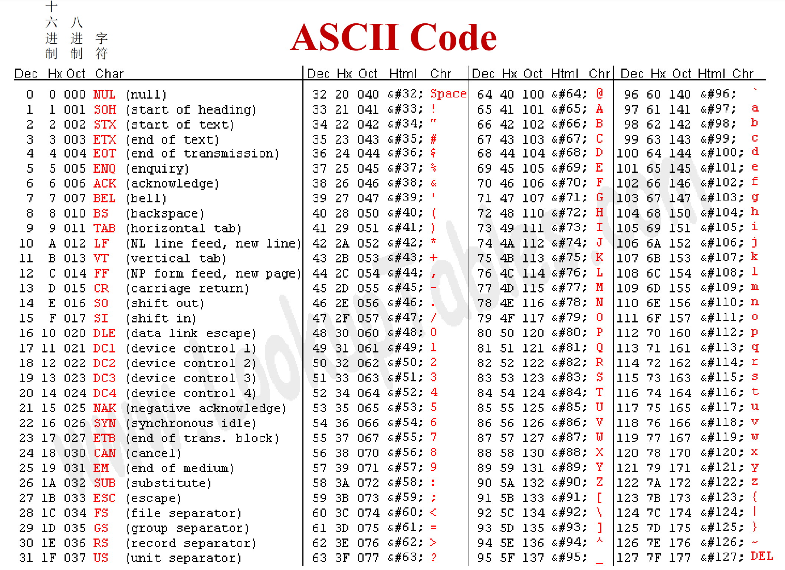
- <mark>🔴ASCII 的位数与内容</mark>
	- 标准 ASCII 码使用<mark>7 位</mark>；扩展 ASCII 码常使用<mark>8 位</mark>。
	- 除可显示字符外，还包含<mark>Tab、LF、CR、BS、ESC</mark>等控制字符。

**[ 例题 ] 单词 help 的 ASCII 十六进制表示**

将字符串 `help` 的各字符写成课件给出的 ASCII 二进制与十六进制表示。

> 解
> 1. `h`：\\(1101000_2=68_{16}\\)；`e`：\\(1100101_2=65_{16}\\)。
> 2. `l`：\\(1101100_2=6C_{16}\\)；`p`：课件印为 \\(1111000_2\\)，同时给出 \\(70_{16}\\)。
> 3. 字符串在存储时按字符顺序保存各代码。
## 2.6 数字代码（digital codes）

### 2.6.1 格雷码（Gray code）

- <mark>🔴格雷码：相邻仅变一位</mark>
	- 格雷码是<mark>非加权码</mark>，不适合直接进行算术运算。
	- 相邻两个格雷码<mark>只有一位变化</mark>，可降低触点不同步造成的瞬时误码。
	- <mark>旋转编码器（rotary encoder）</mark>
		- 码盘跨越相邻位置时，普通二进制码可能有多位同时改变；触点或传感器若未同时稳定，可能短暂读到错误的中间码。
		- 格雷码相邻码字仅改变一位，故切换瞬间最多只有该位不确定，可降低多位不同步引起的误读风险。
- 二进制转格雷码：<mark>最高位不变</mark>，其余每位为相邻两个二进制位的异或。
	- 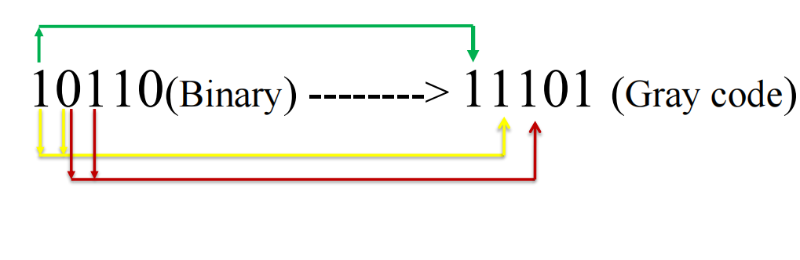
- 格雷码转二进制：<mark>最高位不变</mark>，之后每位为前一位二进制位与当前格雷码位的异或。
	- 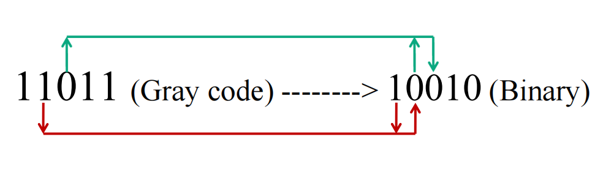

- <mark>🔴四位格雷码的顺序：必须按反射码表读</mark>
	- 格雷码的数值顺序不能按普通二进制位权直接相加；应查表，或按转换规则逐位还原。
	- 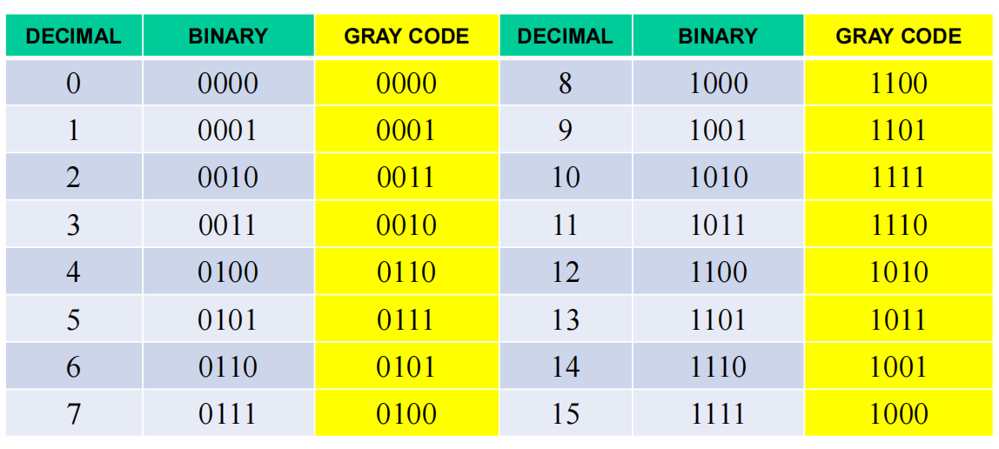

**[ 例题 ] 二进制与格雷码互换**
将二进制数 \\(10110_2\\) 转为格雷码；将格雷码 \\(11011\\) 转为二进制数。

> 解
> 1. \\(10110_2\\) 的最高位保持为 1，随后逐位异或：\\(1\oplus0=1\\)、\\(0\oplus1=1\\)、\\(1\oplus1=0\\)、\\(1\oplus0=1\\)，故格雷码为 \\(11101\\)。
> 2. 格雷码 \\(11011\\) 的最高位为 1；依次恢复二进制位：\\(1\oplus1=0\\)、\\(0\oplus0=0\\)、\\(0\oplus1=1\\)、\\(1\oplus1=0\\)。
> 3. 所以 \\(11011_{\text{Gray}}=10010_2\\)。

### 2.6.2 奇偶校验（parity check）

- <mark>🔴奇偶校验</mark>
	- 在原数据前或后附加<mark>一位校验位（parity bit）</mark>，使整个字中 1 的个数为偶数（偶校验）或奇数（奇校验）。
	- 发送端先数原数据中的 1：偶校验要使总数为偶数，奇校验要使总数为奇数；接收端按同一规则再数一次总数。
- 奇偶校验作用：
	- 一位翻转会改变 1 的总数奇偶性，因而能检出<mark>单bit错误和任意奇数个bit错误</mark>；
	- 偶数个比特同时翻转时奇偶性不变，不能保证检出
	- 也不能定位或纠正错误。

- <mark>BCD 码的一位奇偶校验：先看数据中 1 的个数</mark>

| BCD 数字 | 4 位 BCD | 偶校验位 | 奇校验位 |
| --- | --- | --- | --- |
| 0 | 0000 | 0 | 1 |
| 1 | 0001 | 1 | 0 |
| 2 | 0010 | 1 | 0 |
| 3 | 0011 | 0 | 1 |
| 4 | 0100 | 1 | 0 |
| 5 | 0101 | 0 | 1 |
| 6 | 0110 | 0 | 1 |
| 7 | 0111 | 1 | 0 |
| 8 | 1000 | 1 | 0 |
| 9 | 1001 | 0 | 1 |

**[ 例题 ] 奇校验位的确定**
对 ASCII 字符 `a` 的 7 位码 \\(1100001\\) 和字符 `A` 的 7 位码 \\(1000001\\) 添加奇校验位。

> 解
> 1. `a` 的代码中有 3 个 1，已经是奇数个，因此奇校验位为 0。
> 2. `A` 的代码中有 2 个 1，为偶数个，因此奇校验位为 1。

### 2.6.3 循环冗余校验（Cyclic Redundancy Check, CRC）

- <mark>🔴CRC</mark>：
	 - 用**生成码**构造**校验余数**，再用同一生成码检
	- CRC 是用于<mark>较长数据块的多比特错误检测</mark>方法。让发送端与接收端共享同一套生成和检验规则。
- <mark>🔴基本名词</mark>
	- <mark>原始数据 \\(D\\)</mark>是实际要传输的比特串；本例为 \\(D=11010011\\)。
	- <mark>生成码（generator code）\\(G\\)</mark>。本例 \\(G=1010\\)；它在模 2 除法中充当“除数”
	- <mark>校验余数 \\(R\\)</mark>是发送端用 \\(G\\) 处理补零数据后得到的结果；本例 \\(R=0100\\)。最终发送串<mark>\\(D\\) 后附 \\(R\\)</mark>得到的 \\(D''=110100110100\\)。
- <mark>🔴基本流程</mark>

- <mark>模 2 除法：</mark>
	- 规则：
		- 每一步只做异或，不做普通借位或进位
		- 逐位运算规则为：\\(0\oplus0=0\\)、\\(0\oplus1=1\\)、\\(1\oplus0=1\\)、\\(1\oplus1=0\\)。
	- 从左端取与 \\(G\\) 同样长的窗口；窗口首位为 1 时，与 \\(G\\) 异或；窗口首位为 0 时，不与 \\(G\\) 异或，直接移入下一位。
	- 重复到所有输入位均移入窗口。最后留下的比特串就是<mark>余数 \\(R\\)</mark>。

- <mark>校验的判断：接收端只检查收到的完整串</mark>
	- 发送端先由 \\(D\\) 和 \\(G\\) 求出 \\(R\\)，再发送 \\(D''=D\,+\,R\\)。
	- 接收端用同一个 \\(G\\) 除收到的完整比特串。
	- 课件的判据是：余数为 0，表示<mark>未检测到错误</mark>；余数非 0，表示<mark>检测到错误</mark>。

#### 发送端：用生成码得到校验余数

**[ 例题 ] 发送端生成 CRC 发送串**
已知数据 \\(D=11010011\\)、生成码 \\(G=1010\\)。按照模 2 除法过程求最终发送的 CRC 串，并验证其余数为 0。

> 解
> 1. 在 \\(D\\) 后附 4 个 0：\\(D'=11010011\,0000\\)。
> 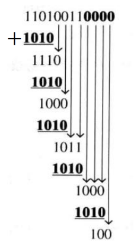
> 2. 从左端取 4 位，按“首位为 1 就异或、首位为 0 就移位”的规则连续处理：
> 	- \\(1101\oplus1010=0111\\)；移入下一个 \\(0\\) 后，窗口为 \\(1110\\)。
> 	- \\(1110\oplus1010=0100\\)；移入下一个 \\(0\\) 后，窗口为 \\(1000\\)。
> 	- \\(1000\oplus1010=0010\\)；移入下一个 \\(1\\) 后，窗口为 \\(0101\\)。
> 	- \\(0101\\) 首位为 0，不异或；移入下一个 \\(1\\) 后，窗口为 \\(1011\\)。
> 	- \\(1011\oplus1010=0001\\)；移入下一个 \\(0\\) 后，窗口为 \\(0010\\)。
> 	- \\(0010\\) 首位为 0，移入下一个 \\(0\\) 后为 \\(0100\\)；再移入下一个 \\(0\\) 后为 \\(1000\\)。
> 	- \\(1000\oplus1010=0010\\)；移入最后一个 \\(0\\) 后，得到余数 \\(R=0100\\)。
> 3. 将 \\(R\\) 附在<mark>原始数据 \\(D\\)</mark>后：\\(D''=11010011\,0100\\)。
> 4. 课件验证：用 \\(G=1010\\) 再除 \\(D''\\)，余数为 0；因此 \\(D''\\) 是本例应发送的 CRC 串。

#### 接收端：用同一生成码检查收到的串

**[ 例题 ] 接收端检测错误**
接收端收到比特串 \\(100100110100\\)，仍使用生成码 \\(G=1010\\)。判断是否检测到传输错误。

> 解
> 1. 直接用 \\(G=1010\\) 对收到的完整比特串作模 2 除法；
> 2. 课件 p.68 给出的余数为 \\(0100\\)。
> 3. 因为 \\(0100\ne0\\)，不满足“完整发送串除以 \\(G\\) 余数为 0”的条件，故<mark>检测到传输错误</mark>。

📝 待插图

- 来源：第二章课件 pp. 66–68。
- 用途：对应发送端的模 2 长除过程、余数 \\(0100\\)、发送串验证，以及接收端余数非 0 的错误判定。
- 截图范围：p. 66 的逐窗异或过程，p. 67–68 的发送/接收验证图。

# 第三章：逻辑门（logic gate）与逻辑系列（logic family）

## 3.1 基本逻辑门（logic gates）

同一逻辑门可用<mark>逻辑符号、真值表、时序图、逻辑表达式</mark>描述。

| 门              | 逻辑关系                | 两输入时的输出规律 |
| -------------- | ------------------- | --------- |
| 非门（NOT）        | \\(X=\bar A\\)          | 输出与输入相反。  |
| 与门（AND）        | \\(X=AB\\)              | 全1才1      |
| 或门（OR）         | \\(X=A+B\\)             | 有1即1      |
| 与非门（NAND gate） | \\(X=\overline{AB}\\)   | 全1才0      |
| 或非门（NOR gate）  | \\(X=\overline{A+B}\\)  | 有1即1      |
| 异或门（XOR gate）  | \\(X=\bar AB+A\bar B\\) | 不同则 1     |
| 同或门（XNOR gate） | \\(X=AB+\bar A\bar B\\) | 相同则 1     |

- <mark>读逻辑门的统一方法：先写输出为 1 的条件</mark>
	- <mark>真值表</mark>列出所有输入组合；\\(n\\) 个输入变量共有 \\(2^n\\) 行。表达式中的上划线表示反，乘积表示“同时满足”，加号表示“满足其一”。
	- <mark>时序图</mark>不改变门的逻辑关系：在每个输入跳变时刻把时间轴分段，再按该门的输出条件逐段确定输出。

### 3.1.1 非门（NOT gate）
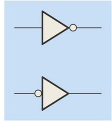

| \\(A\\) | \\(X=\bar A\\) |
| --- | ---------- |
| 0   | 1          |
| 1   | 0          |

### 3.1.2 与门（AND gate）
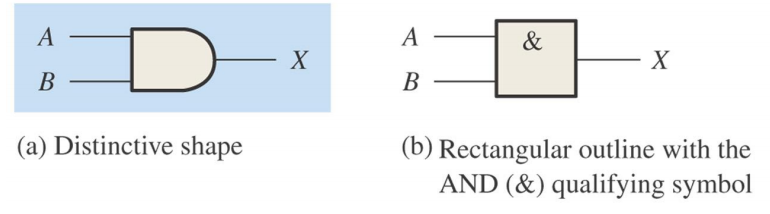

| \\(A\\) | \\(B\\) | \\(X=AB\\) |
| --- | --- | --- |
| 0 | 0 | 0 |
| 0 | 1 | 0 |
| 1 | 0 | 0 |
| 1 | 1 | 1 |

与门的表达式为 \\(X=AB\cdots\\)

### 3.1.3 或门（OR gate）
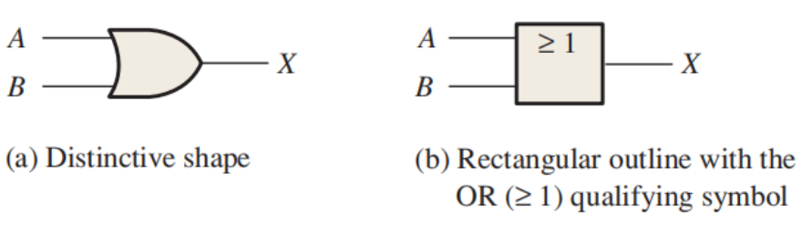

| \\(A\\) | \\(B\\) | \\(X=A+B\\) |
| --- | --- | ------- |
| 0   | 0   | 0       |
| 0   | 1   | 1       |
| 1   | 0   | 1       |
| 1   | 1   | 1       |

### 3.1.4 与非门（NAND gate）和或非门（NOR gate）

- <mark>🔴与非、或非的负逻辑等效</mark>
	- \\(\overline{AB}=\bar A+\bar B\\)：与非门在负逻辑观点下等效为<mark>或门</mark>。
	- \\(\overline{A+B}=\bar A\bar B\\)：或非门在负逻辑观点下等效为<mark>与门</mark>。
- 与非门和或非门都是<mark>通用门</mark>，可构成与、或、非三类基本功能。

与非门：
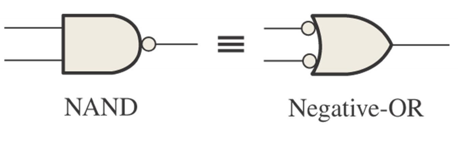
或非门：
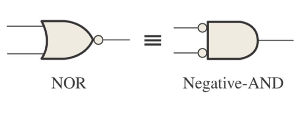

| \\(A\\) | \\(B\\) | \\(\overline{AB}\\)（与非） | \\(\overline{A+B}\\)（或非） |
| --- | --- | ------------------- | -------------------- |
| 0   | 0   | 1                   | 1                    |
| 0   | 1   | 1                   | 0                    |
| 1   | 0   | 1                   | 0                    |
| 1   | 1   | 0                   | 0                    |

### 3.1.5 异或门（XOR gate）和同或门（XNOR gate）
1. 异或门（XOR , Exclusive-OR）
- 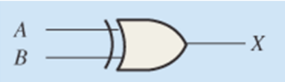

1. 同或门（异或非，XNOR, Exclusive-NOR）
- 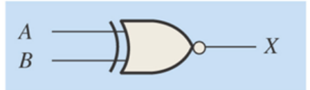

| \\(A\\) | \\(B\\) | \\(A\oplus B\\)（异或） | \\(A\odot B\\)（同或） |
| --- | --- | --------------- | -------------- |
| 0   | 0   | 0               | 1              |
| 0   | 1   | 1               | 0              |
| 1   | 0   | 1               | 0              |
| 1   | 1   | 0               | 1              |

## 3.2 数字集成电路的性能指标

### 3.2.1 逻辑电平与噪声容限（noise margin）

- <mark>🔴逻辑电平</mark>
	- 输入阈值：\\(V_{IL(\max)}\\) 是可识别低电平的最大输入电压；\\(V_{IH(\min)}\\) 是可识别高电平的最小输入电压。
	- 输出边界：\\(V_{OL(\max)}\\) 是低电平输出的最大电压；\\(V_{OH(\min)}\\) 是高电平输出的最小电压。
- <mark>🔴噪声容限</mark>
	- 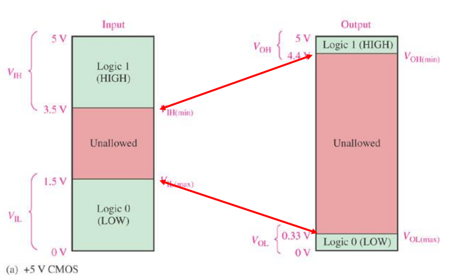
	- ==\\(V_{NL}=V_{IL(\max)}-V_{OL(\max)}\\)<mark>，</mark>\\(V_{NH}=V_{OH(\min)}-V_{IH(\min)}\\)==。

+5V CMOS：
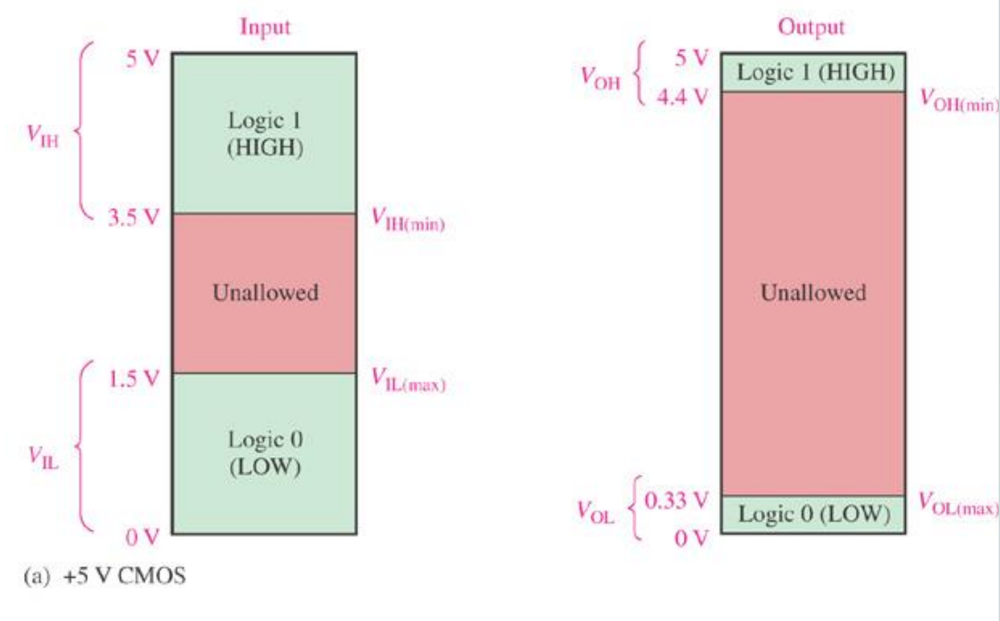
+3.3V CMOS:
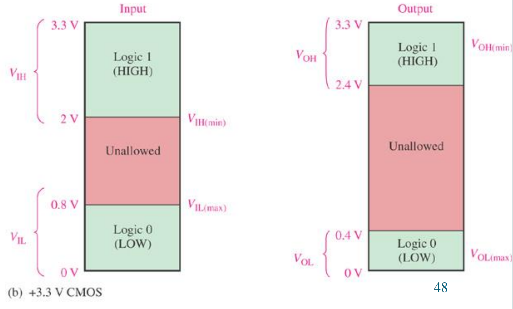
+5V TTL
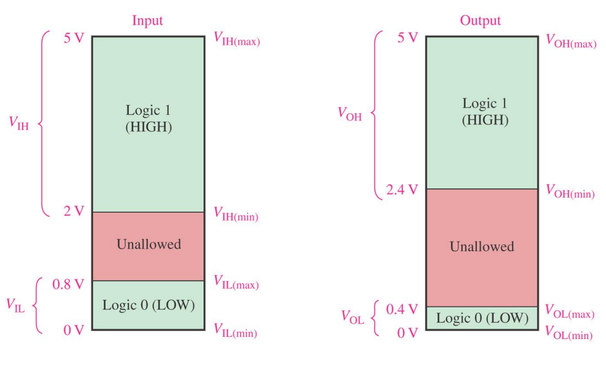

**[ 例题 ] 按课件参数计算噪声容限**
按上图中给出的 CMOS 与 TTL 逻辑电平参数，计算各自的高、低电平噪声容限。

> 解
> 1. CMOS：\\(V_{NL}=1.5-0.33=1.17\\) V，\\(V_{NH}=4.4-3.5=0.9\\) V。
> 2. TTL：\\(V_{NL}=0.8-0.4=0.4\\) V，\\(V_{NH}=2.4-2.0=0.4\\) V。
> 3. 噪声容限越大，逻辑状态对噪声扰动的容忍能力越强。

### 3.2.2 功耗（power dissipation）、速度与扇出（fan-out）

- <mark>🔴功耗、速度</mark>
	- <mark>平均功耗：</mark> \\(P_D=V_{CC}(I_{CCH}+I_{CCL})/2\\)（用逻辑门输出高、低输出状态的电源电流给出）
	- <mark>传播延迟</mark>（propagation delay）是输入变化到输出稳定之间的时间。
		- 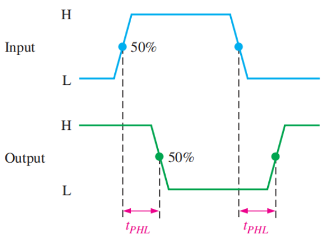
		- \\(t_{PLH}\\) 量低到高的输出延迟
		- \\(t_{PHL}\\) 量高到低的输出延迟
		- 常用**\\(t_p=(t_{PLH}+t_{PHL})/2\\)**表示。
	- <mark>速度—功耗积（speed-power product, SPP）</mark>
		- \\(SPP=t_pP_D\\)；
		- 它把“快”和“省电”放在同一指标下比较，数值越小越有利。

- <mark>🔴扇出</mark>
	- <mark>扇出（fan-out）</mark>是一个门的输出端连接了多少个同类门的输入端。
	- TTL 要分别核对低电平灌电流与高电平拉电流，取两者允许负载数中较小者；
	- CMOS 虽然直流输入电流很小，输入电容仍会在负载增多时拉慢边沿。
		- CMOS 门电路的**工作频率与扇出**有关
   - 扇出越大 → 电容越大 → 频率越低

- <mark>🔴负载</mark>
	- \\(Unit Loads（单位负载）= I_{OL} / I_{IL}\\)
	 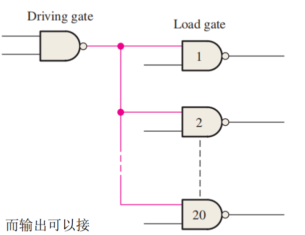
	- <mark>CMOS 负载</mark>：
	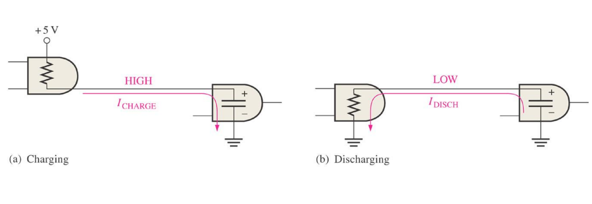
	- <mark>TTL 负载</mark>：
	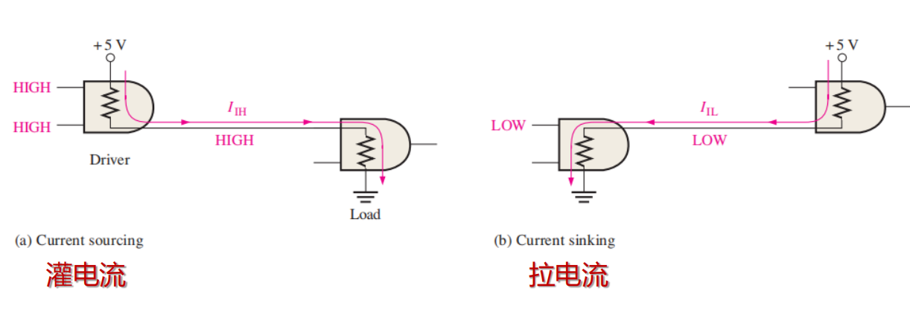
	 - <mark>TTL 多负载</mark>：
		 - 灌电流：扇出 ↑  源电流 ↑  内部压降 ↑  \\(V_{OH}\\)​ ↓ 直到 >\\(V_{OHmin}\\) → 错误  噪声容限 ↓  功耗 ↑
	  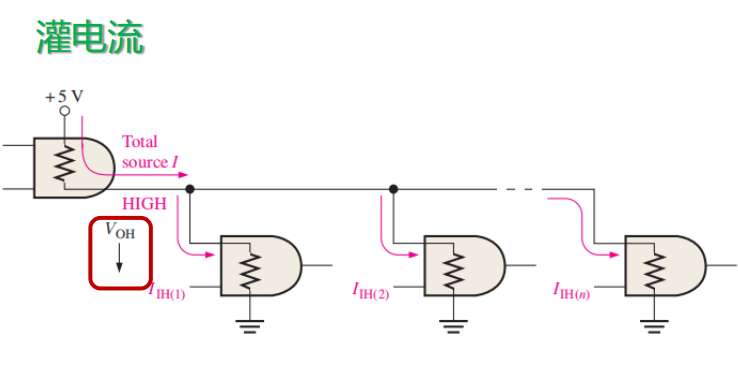
		 - 拉电流：扇出 ↑  吸入电流 ↑  内部压降 ↑  \\(V_{OL}\\)​ ↑ 直到 >\\(V_{OLmax}\\) → 错误  噪声容限 ↓  功耗 ↑
	  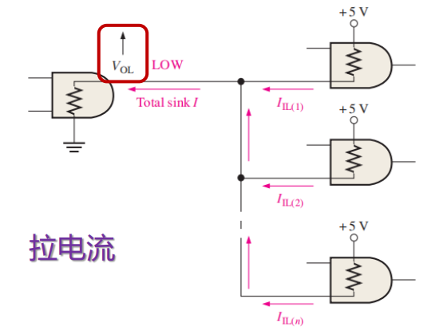

**[ 例题 ] TTL 低电平扇出**
一个 TTL 门在低电平时最大灌电流（输出可以接收的低电平电流）为 8 mA，每个同系列 TTL 输入在低电平时需要 0.4 mA。求该输出的低电平扇出。

> 解
> 1. 扇出由可提供的输出电流除以每个输入所需电流确定。
> 2. \\(\text{fan-out}=8\text{ mA}/0.4\text{ mA}=20\\)。
> 3. 因而该输出最多可驱动 20 个这种单位负载

## 3.3 CMOS（Complementary Metal-Oxide-Semiconductor）逻辑电路

- <mark>🔴CMOS组成</mark>
	- CMOS由**N 型 MOSFET**和**P 型 MOSFET**互补组成。
- <mark>🔴MOS管理想开关</mark>
	- NMOS：栅极为 \\(+5\,\text{V}\\) 时导通，等效为闭合开关；栅极为 \\(0\,\text{V}\\) 时截止，等效为断开开关。
		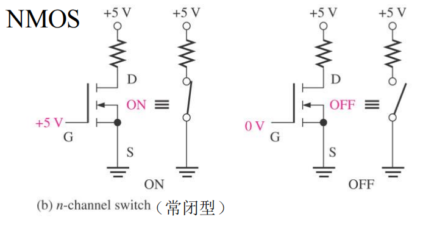
	- PMOS：栅极为 \\(0\,\text{V}\\) 时导通，等效为闭合开关；栅极为 \\(+5\,\text{V}\\) 时截止，等效为断开开关。
		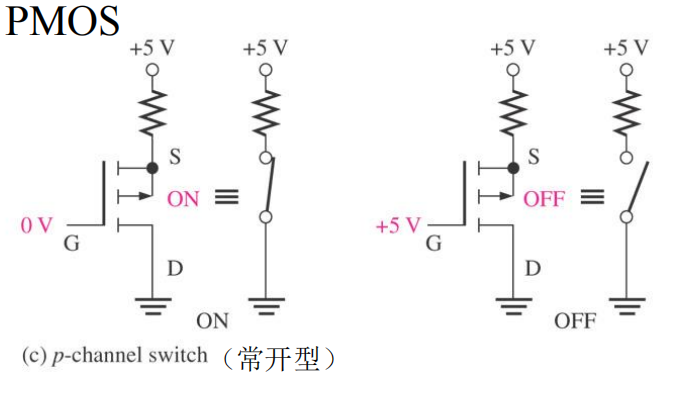

- <mark>🔴CMOS 反相器的连接方式</mark>
	- 上管 \\(Q_1\\)  PMOS，源极接 \\(+V_{DD}\\)；下管 \\(Q_2\\)  NMOS，源极接地。两管栅极共接输入，两管漏极共接输出。
	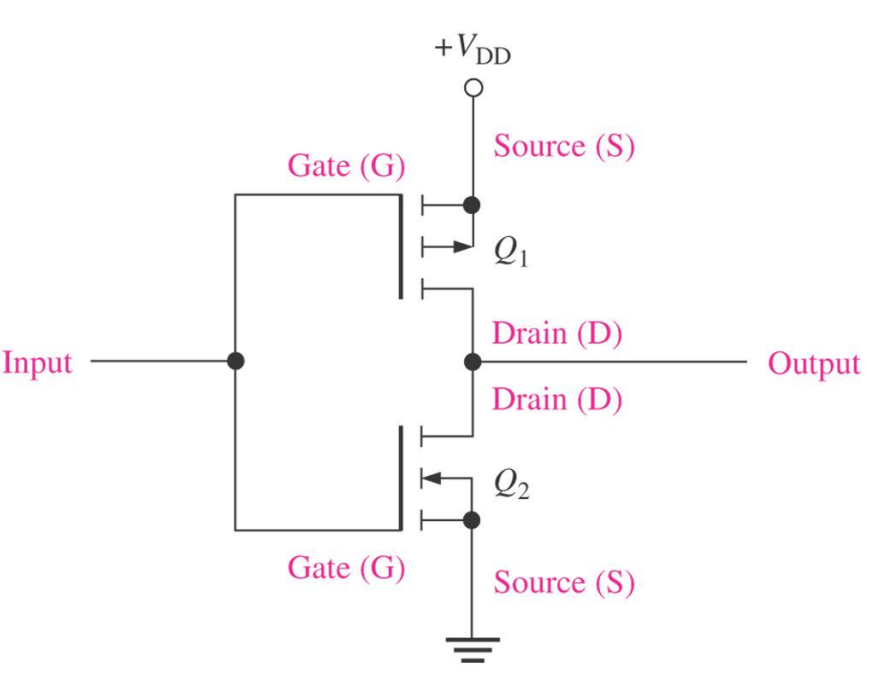
- <mark>🔴CMOS 反相器的两种状态</mark>
	- 输入高电平时，\\(Q_1\\) 截止、\\(Q_2\\) 导通，输出被接到低电平端
	- 输入低电平时，\\(Q_1\\) 导通、\\(Q_2\\) 截止，输出被接到 \\(+V_{DD}\\)

- <mark>🔴CMOS NAND（与非门)</mark>
	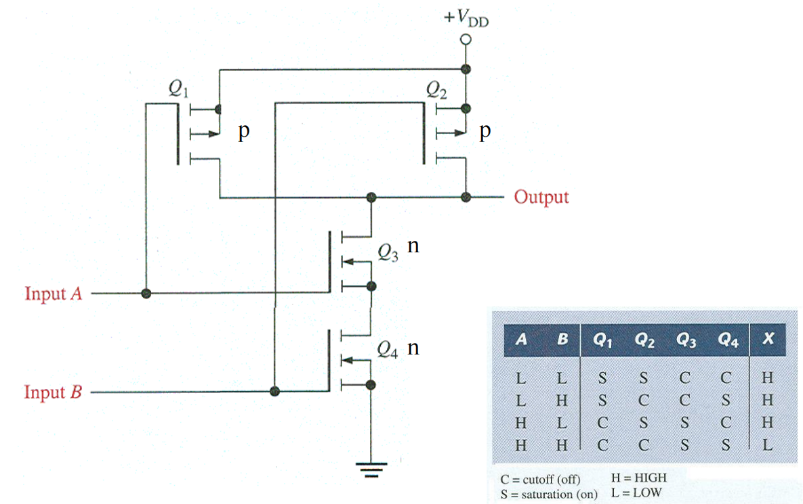
	- NAND 门的上拉 PMOS \\(Q_1,Q_2\\) 为<mark>并联</mark>，下拉 NMOS \\(Q_3,Q_4\\) 为<mark>串联</mark>。因此仅当 \\(A,B\\) 都为高电平时，下拉通路完整且输出为低电平。
	- 表中 \\(S\\) 表示饱和（ON），\\(C\\) 表示截止（OFF），\\(H/L\\) 分别表示高/低电平。

- <mark>🔴CMOS NOR （或非门）</mark>
 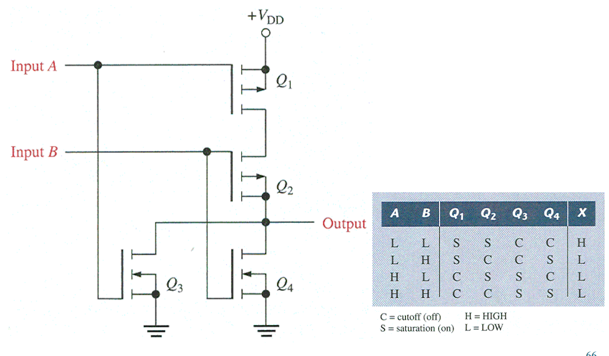
	- NOR 门的上拉 PMOS \\(Q_1,Q_2\\) 为<mark>串联</mark>，下拉 NMOS \\(Q_3,Q_4\\) 为<mark>并联</mark>。因此只有 \\(A,B\\) 都为低电平时，上拉通路完整且输出为高电平。

- <mark>🔴CMOS开漏输出（open-drain）</mark>
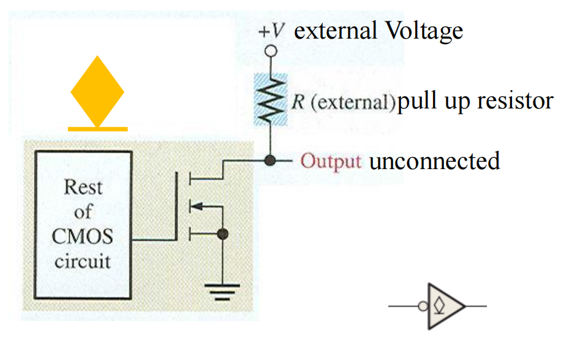
	- NMOS 导通时，输出被拉到低电平；NMOS 截止时，输出端呈开路，必须通过**外接电源与上拉电阻**得到高电平。

- <mark>🔴CMOS三态门</mark>
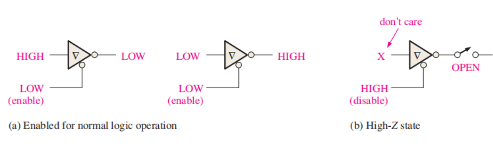
	- 图中的三态 CMOS 反相器使用低有效使能端：使能端为低电平时，按普通反相器工作。
	- 使能端为高电平时，输出端断开并进入**高阻态（high-Z）**；此时输入 \\(X\\) 为无关项（don't care），输出既不是 0 也不是 1。

## 3.4 TTL（Transistor-Transistor Logic）逻辑电路

- <mark>🔴BJT理想开关</mark>
	- BJT 正常工作时，基极-发射极结正偏，基极-集电极结反向偏置。
	- 作开关使用时，晶体管**饱和**对应导通的闭合开关，集电极电流可从 \\(V_{CC}\\) 经负载流向地；输入为 \\(0\,\text{V}\\) 时晶体管**截止**，对应断开的开关。
		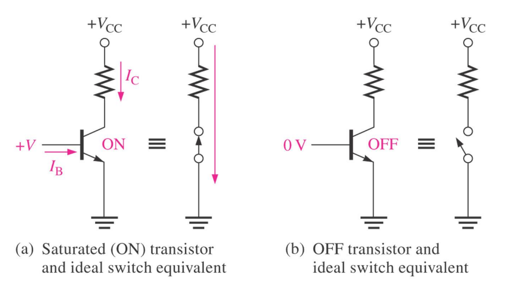

- <mark>🔴标准 TTL **反相器**</mark>
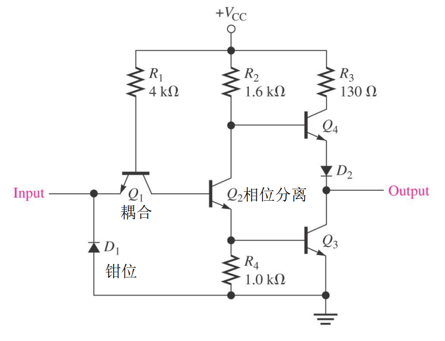
	- 电路由输入级 \\(Q_1\\)、钳位二极管 \\(D_1\\)、相位分离级 \\(Q_2\\) 以及输出级构成；\\(Q_2\\) 的作用是把控制信号分给上、下两条输出支路。
	- 输出级中的 \\(Q_4\\) 为上拉支路，\\(Q_3\\) 为下拉支路，二者形成**图腾柱（totem-pole）** 输出；\\(D_2\\) 位于上拉支路。
- <mark>🔴工作原理</mark>
	- 输入为高电平时，\\(Q_1\\) 输入结反向偏置，\\(Q_2\\)、\\(Q_3\\) 导通而 \\(Q_4\\) 截止，输出为低电平。
	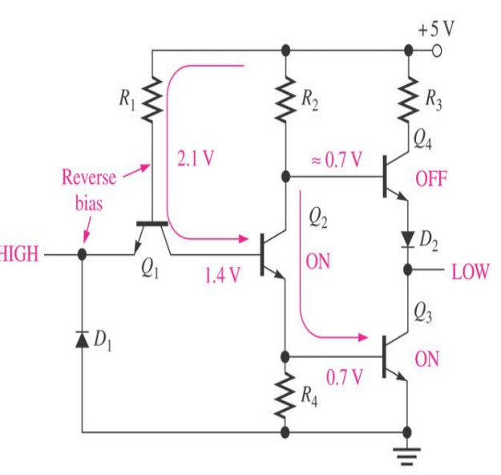
	- 输入为低电平（\\(0\,\text{V}\\)）时，\\(Q_2\\)、\\(Q_3\\) 截止而 \\(Q_4\\) 导通，输出为高电平；这就是“输入 0 输出 1、输入 1 输出 0”。
	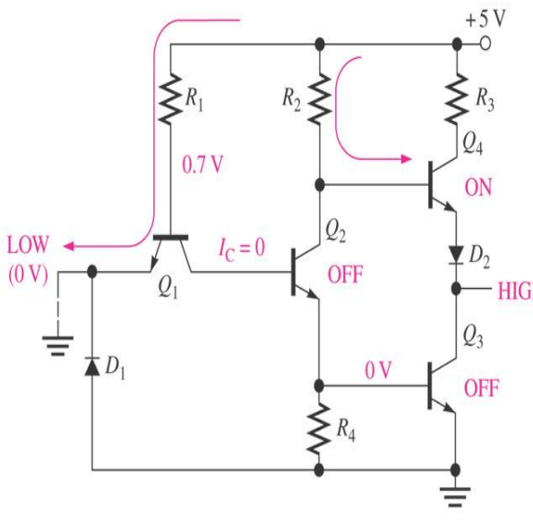

- <mark>🔴TTL **与非门（NAND）**</mark>
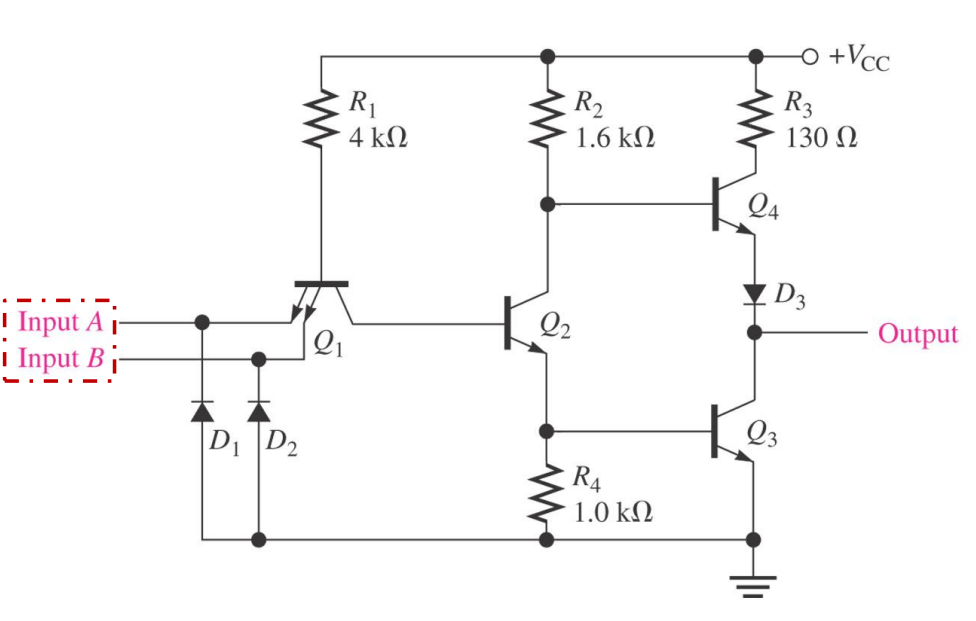
	-  对比TTL的反相器电路，NAND门的差别仅在输入级使用了**多发射极晶体管** \\(Q_1\\)
	- 多输入TTL与非门满足：**任一输入为 0，输出为 1；全部输入为 1，输出为 0**。

- <mark>🔴开集电极（open-collector）</mark>反相器的输出取自下拉晶体管集电极，内部没有主动上拉支路；要获得高电平，需要接**外部上拉电阻**。
	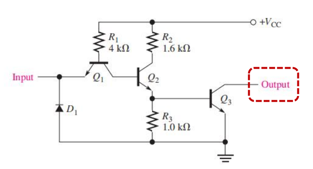

- <mark>🔴三态反相器：</mark>
	- \\(EN=0\\)时**按反相器工作**，\\(EN=1\\)时输出为**高阻态**（high-impedance）。
	- 工作原理：
		-  Enable = 1：Q2 导通，使 Q3 截止；同时通过 D1 使 Q4 截止，Q5 也截止，输出为高阻态 Z。
		- Enable = 0，Input = 0：Q2 截止，Q1 将 Q3 基极拉低，Q3 截止，Q4 导通，Q5 截止，输出高电平 1。
		- Enable = 0，Input = 1：Q2 截止，Q1 向 Q3 提供基极电流，Q3 导通，Q4 截止，Q5 导通，输出低电平 0。
	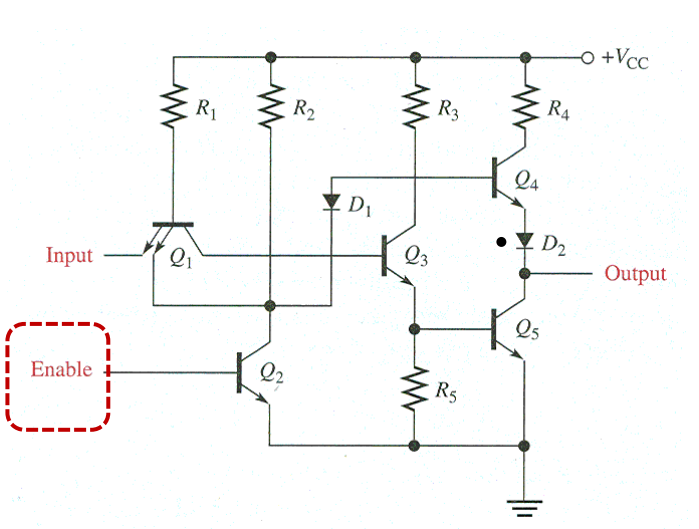

- <mark>🔴速度特点</mark>： 肖特基 TTL（Schottky TTL）==是开关速度较快的一类 TTL。

## 3.5 TTL 逻辑门的连接与使用

- <mark>🔴输出为高、低时的电流作用</mark>
	- 图腾柱输出为高电平时，上拉支路向外部负载提供电流，称为**电流拉出**（current sourcing）； \\(I_{IH}=40\,\mu\text{A}\\)。
	 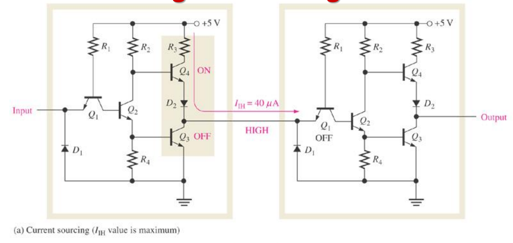
	- 图腾柱输出为低电平时，下拉支路把电流引向地，称为**电流灌入**（current sinking）； \\(I_{IL}=1.6\,\text{mA}\\)。
	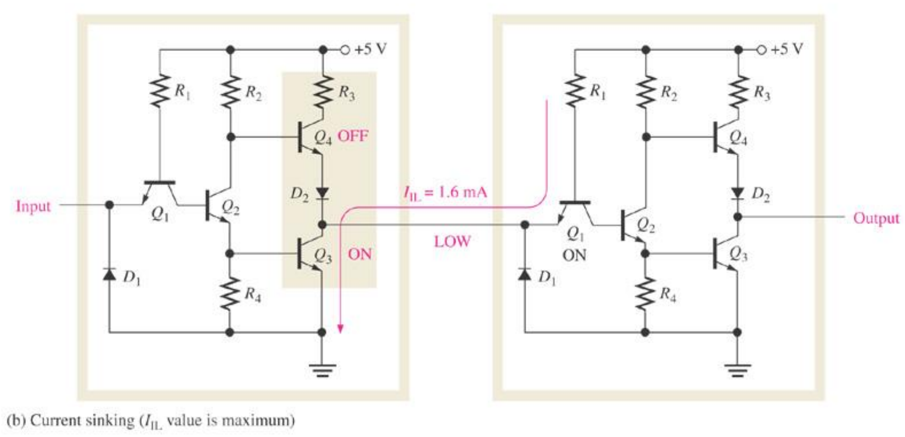
	- 可见灌电流通常远大于拉电流

- <mark>🔴图腾柱输出相连</mark>
	- 两图腾柱**输出相连**时，若 A 的上拉晶体管导通而 B 的下拉晶体管导通，会从 \\(+5\,\text{V}\\) 经两器件形成过**过电流**。因此**输出不相连**
	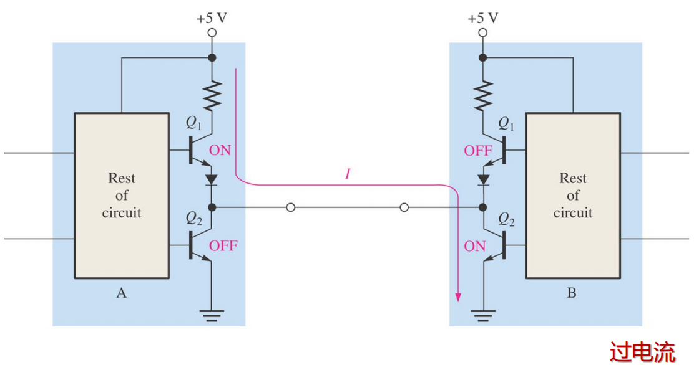

- <mark>🔴开集电极的外接负载</mark>
	- **开集电极门**需要**外部上拉或负载支路**。输出晶体管导通时把节点拉低，电流经外部负载流过；晶体管截止时无此电流通路。
	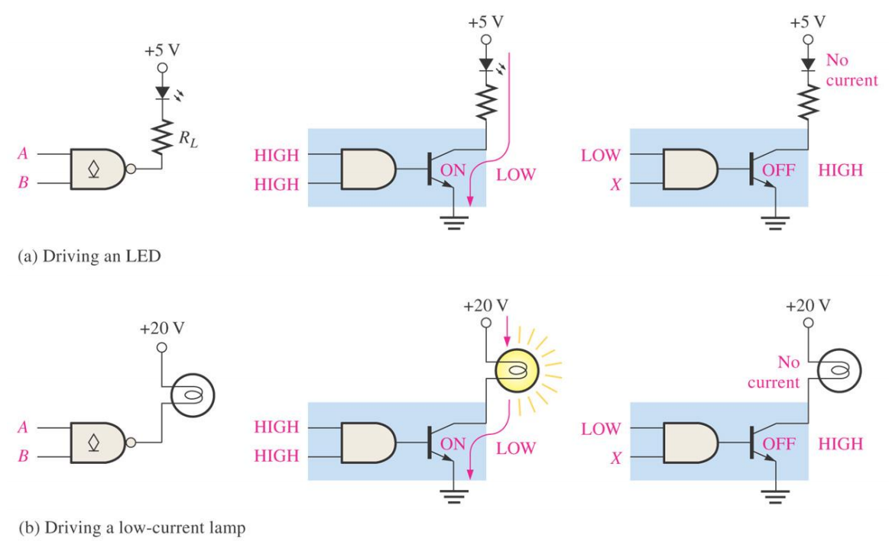

- <mark>🔴开集电极输出的线与</mark>（wired-AND）
	- 传统连接多输出的方式需要多一个与门：
	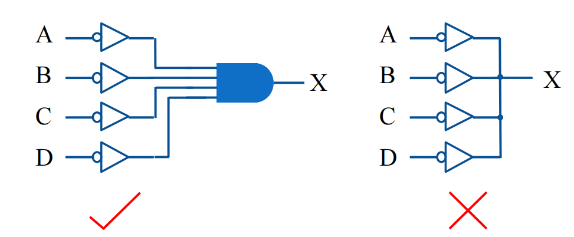
	- 但若**输出**是**集电极开路**时，那么多个输出可接到同一节点，并由外部上拉电阻决定无人下拉时的高电平。
	- 公共输出逻辑：**只要一个或多个**输出晶体管导通，公共节点就是**低电平**；只有**所有**输出晶体管都截止，公共节点才被上拉为**高电平**。
	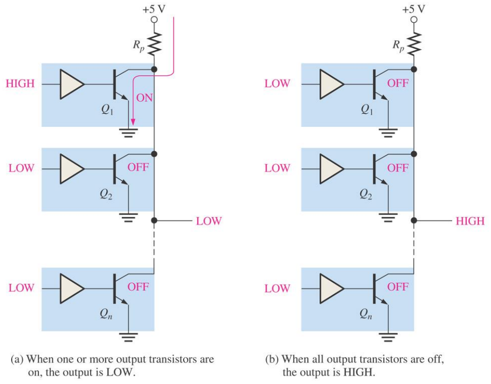

- <mark>🔴未使用 TTL 输入</mark>
	- **悬空 TTL 输入通常表现为高电平**，原因是输入晶体管的发射结处于反向偏置；但实际中不应让未使用输入保持悬空。
	- 三种处理方法（需使输入逻辑确定，且不影响原逻辑）：
		- 把**未用输入与一个已用输入**相连；
		- **接到 \\(V_{CC}\\) 或地**；
		- 接到未使用门的输出端。

## 3.6 固定功能逻辑芯片与 74xx 系列

- <mark>🔴固定功能逻辑芯片：先读编号，再比较系列参数</mark>
	- <mark>74LS04 的编号含义</mark>
		- 对<mark>\\(74\mathrm{LS}04\\)</mark>：`74` 表示系列，`LS` 表示<mark>低功耗肖特基 TTL（Low-power Schottky TTL）</mark>，`04` 表示<mark>六反相器（hex inverter）</mark>。
	- <mark>课件列出的逻辑技术类别</mark>
		- 固定功能逻辑芯片按技术分为<mark>双极型 TTL（Bipolar TTL）</mark>、<mark>BiCMOS</mark>和<mark>CMOS</mark>；课件的 CMOS 比较又按 \\(5\,\text{V}\\) 与 \\(3.3\,\text{V}\\) 系列列出。
		- 双极型 TTL 包括 F（高速）、LS（低功耗）和 ALS（先进低功耗）；课件还列出 BiCMOS 的 ABT、\\(5\,\text{V}\\) CMOS 的 HC/AC/AHC，以及 \\(3.3\,\text{V}\\) CMOS 的 LV/LVC/ALVC。
	- <mark>课件的系列性能对比：双极型 TTL 与 BiCMOS</mark>

| 系列 | 传播延迟 \\(t_p\\) | 最大时钟频率 | 每门功耗 | 输出驱动 \\(I_{OL}\\) |
| --- | --- | --- | --- | --- |
| F | \\(3.3\,\text{ns}\\) | \\(145\,\text{MHz}\\) | \\(6\,\text{mW}\\) | \\(20\,\text{mA}\\) |
| LS | \\(10\,\text{ns}\\) | \\(33\,\text{MHz}\\) | \\(2.2\,\text{mW}\\) | \\(8\,\text{mA}\\) |
| ALS | \\(7\,\text{ns}\\) | \\(45\,\text{MHz}\\) | \\(1.4\,\text{mW}\\) | \\(8\,\text{mA}\\) |
| ABT（BiCMOS） | \\(3.2\,\text{ns}\\) | \\(150\,\text{MHz}\\) | \\(17\,\text{mW}\\) | \\(64\,\text{mA}\\) |

- <mark>🔴CMOS 系列性能对比：电源电压也是条件</mark>
	- <mark>\\(5\,\text{V}\\) CMOS</mark>

| 系列 | 传播延迟 \\(t_p\\) | 最大时钟频率 | 静态功耗 | 输出驱动 \\(I_{OL}\\) |
| --- | --- | --- | --- | --- |
| HC | \\(7\,\text{ns}\\) | \\(50\,\text{MHz}\\) | \\(2.75\,\mu\text{W}\\) | \\(4\,\text{mA}\\) |
| AC | \\(5\,\text{ns}\\) | \\(160\,\text{MHz}\\) | \\(0.55\,\mu\text{W}\\) | \\(24\,\text{mA}\\) |
| AHC | \\(3.7\,\text{ns}\\) | \\(170\,\text{MHz}\\) | \\(2.75\,\mu\text{W}\\) | \\(8\,\text{mA}\\) |
- <mark>\\(3.3\,\text{V}\\) CMOS</mark>

| 系列 | 传播延迟 \\(t_p\\) | 最大时钟频率 | 静态功耗 | 输出驱动 \\(I_{OL}\\) |
| --- | --- | --- | --- | --- |
| LV | \\(9\,\text{ns}\\) | \\(90\,\text{MHz}\\) | \\(1.6\,\mu\text{W}\\) | \\(12\,\text{mA}\\) |
| LVC | \\(4.3\,\text{ns}\\) | \\(100\,\text{MHz}\\) | \\(0.8\,\mu\text{W}\\) | \\(24\,\text{mA}\\) |
| ALVC | \\(3\,\text{ns}\\) | \\(150\,\text{MHz}\\) | \\(0.8\,\mu\text{W}\\) | \\(24\,\text{mA}\\) |

# 第四章：布尔代数（Boolean algebra）与逻辑化简

## 4.1 布尔变量（Boolean variable）、文字（literal）与运算符

- <mark>🔴逻辑变量与反变量</mark>
	- <mark>逻辑变量</mark>只能取 0 或 1；反变量（补）表示相反逻辑值，记作 \\(\bar A\\)。
- <mark>🔴文字（literal）</mark>
	- **变量或其反变量统称为文字。**
- <mark>🔴基本运算符</mark>
	- 加号 \\(+\\) 表示<mark>逻辑或</mark>，连接或乘号表示<mark>逻辑与</mark>，例如 \\(AB=A\cdot B\\)。

## 4.2 布尔代数基本定律

- <mark>🔴交换律与结合律</mark>
	- <mark>交换律</mark>：\\(A+B=B+A\\)，\\(AB=BA\\)；
	- <mark>结合律</mark>：\\((A+B)+C=A+(B+C)\\)，\\((AB)C=A(BC)\\)。
- <mark>🔴分配律</mark>
	- \\(A(B+C)=AB+AC\\)，\\(A+BC=(A+B)(A+C)\\)；
	- **它既可用于展开，也可反向用于因式分解。**
- <mark>🔴恒等律、零律与互补律</mark>
	- <mark>恒等律与零律</mark>：\\(A+0=A\\)，\\(A\cdot1=A\\)，\\(A+1=1\\)，\\(A\cdot0=0\\)。
	- <mark>幂等律、互补律、双重否定</mark>：\\(A+A=A\\)，\\(AA=A\\)，\\(A+\bar A=1\\)，\\(A\bar A=0\\)，\\(\overline{\bar A}=A\\)。
- <mark>🔴吸收律</mark>
	- \\(A+AB=A\\)，\\(A(A+B)=A\\)；**含有 \\(A\\) 的较复杂项可被 \\(A\\) 吸收。**
	- \\(AB+\bar AC + BC=AB+\bar AC\\)
- <mark>🔴推论</mark>
	- \\(A+\bar AB=A+B\\)，以及 \\((A+B)(A+C)=A+BC\\)。

**[ 例题 ] 证明 \\((A+B)(A+C)=A+BC\\)**
用布尔代数证明 \\((A+B)(A+C)=A+BC\\)。

> 解
> 1. 展开：\\((A+B)(A+C)=AA+AC+AB+BC\\)。
> 2. 用幂等律化为 \\(A+AC+AB+BC\\)。
> 3. 提取 \\(A\\)：\\(A(1+C+B)+BC\\)。
> 4. 因为 \\(1+C+B=1\\)，所以结果为 \\(A+BC\\)。

## 4.3 德摩根定律（De Morgan's laws）

- <mark>🔴对乘积取反</mark>
	- **乘积的反等于各因子反的和。**\\(\overline{AB}=\bar A+\bar B\\)。
	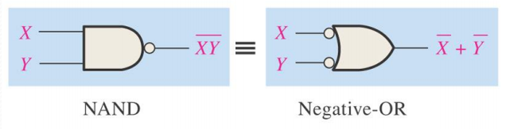
- <mark>🔴对和取反</mark>
	- **和的反等于各项反的积。**\\(\overline{A+B}=\bar A\bar B\\)。
	 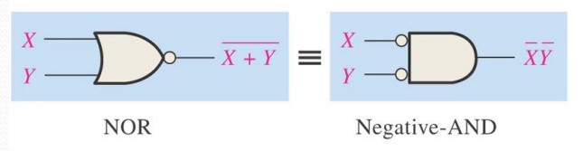
- <mark>🔴多变量的德摩根定律</mark>
	- 对多变量同样成立：\\(\overline{XYZ}=\bar X+\bar Y+\bar Z\\)，\\(\overline{X+Y+Z}=\bar X\bar Y\bar Z\\)；**取反穿过括号时，运算符必须互换。**

**[ 例题 ] 对含多个乘积项的表达式取反**

写出 \\(\overline{\bar A B C+A\bar B C+AB\bar C}\\) 的等价乘积和形式。

> 解
> 1. 对最外层的和使用德摩根定律，得到各乘积项反的乘积。
> 2. 分别对每个乘积项取反：\\(\overline{\bar A B C}=A+\bar B+\bar C\\)，\\(\overline{A\bar B C}=\bar A+B+\bar C\\)，\\(\overline{AB\bar C}=\bar A+\bar B+C\\)。
> 3. 因而原式等于 \\((A+\bar B+\bar C)(\bar A+B+\bar C)(\bar A+\bar B+C)\\)。

## 4.4 用布尔代数化简逻辑电路

- <mark>🔴列写中间节点与输出表达式</mark>
	1. 按门电路连接关系写出<mark>中间节点</mark>与<mark>输出表达式</mark>。
	2. 先处理最内层门的输出，再代入后级；**反相小圆圈或上划线的作用范围必须用括号明确。**
- <mark>🔴使用布尔代数基本定律化简</mark>
	1. 使用<mark>基本定律</mark>、<mark>吸收律</mark>、<mark>德摩根定律</mark>化简。
- <mark>🔴验证化简前后的功能</mark>
	1. 用<mark>真值表</mark>或<mark>逻辑等价关系</mark>确认功能不变。

**[ 例题 ] 由门电路写出并化简输出函数**
某门电路的输出函数为 \\(Y=AB+A(B+C)+B(B+C)\\)。将其化简。

> 解
> 1. 合并前两项：\\(AB+A(B+C)=A(B+B+C)=A(B+C)\\)。
> 2. 因而 \\(Y=A(B+C)+B(B+C)=AB+AC+B+BC\\)。
> 3. 利用 \\(B+AB=B\\)、\\(B+BC=B\\)，得 \\(Y=B+AC\\)。
> 4. 因此原电路可由一个与门产生 \\(AC\\)，再与 \\(B\\) 经过或门得到输出。

**[ 例题 ] 根据表达式确定逻辑电路的输出条件**

课件电路的输出为 \\(Y=A(B+CD)\\)。说明 \\(Y\\) 在哪些输入条件下为 1。

> 解
> 1. 当 \\(A=0\\) 时，\\(Y=0\\)，无论 \\(B,C,D\\) 取何值。
> 2. 当 \\(A=1,B=1\\) 时，括号内为 1，故 \\(Y=1\\)，无论 \\(C,D\\) 取何值。
> 3. 当 \\(A=1,B=0\\) 时，只有 \\(C=1,D=1\\) 使 \\(CD=1\\)，此时 \\(Y=1\\)。
> 4. 所以输出为 1 的条件是 \\(A=1\\) 且“\\(B=1\\) 或 \\(C,D\\) 同时为 1”，这与表达式 \\(A(B+CD)\\) 一致。

**[ 例题 ] 吸收化简**
化简 \\(Y_1=(\overline{\bar A B}+C)ABD+AD\\)，以及 \\(Y_2=AB+AB\bar C+ABD+AB(\bar C+\bar D)\\)。

> 解
> 1. 对 \\(Y_1\\)，先把与 \\(B\\) 相乘的部分合并：\\(Y_1=[(\overline{\bar A B}+C)B]AD+AD\\)；后项 \\(AD\\) 吸收前项，故 \\(Y_1=AD\\)。
> 2. 对 \\(Y_2\\)，提取 \\(AB\\)：\\(Y_2=AB[1+\bar C+D+(\bar C+\bar D)]\\)。
> 3. 方括号中含有 1，故 \\(Y_2=AB\\)。

**[ 例题 ] 利用 \\(A+\bar AB=A+B\\) 化简**
化简下列三个函数：\\(Y_1=\bar B+ABC\\)，\\(Y_2=A\bar B+B+\bar A B\\)，\\(Y_3=AC+\bar AD+\bar CD\\)。

> 解
> 1. \\(Y_1=\bar B+ABC=\bar B+AC\\)，使用 \\(\bar B+B(AC)=\bar B+AC\\)。
> 2. \\(Y_2=A\bar B+B+\bar A B=A+B+\bar A B=A+B\\)。
> 3. \\(Y_3=AC+(\bar A+\bar C)D=AC+\overline{AC}D=AC+D\\)。

**[ 例题 ] 展开最小项后再合并**
化简 \\(Y=A\bar B+\bar AB+B\bar C+\bar BC\\)。

> 解
> 1. 对需要配对的项乘以 \\(C+\bar C\\) 或 \\(A+\bar A\\)，把它们展开为含相同变量数的乘积项。
> 2. 按课件的配对合并，可得 \\(Y=A\bar B+B\bar C+\bar AC\\)。
> 3. 该过程展示了“引入互补项后再用相邻最小项合并”的思路。

## 4.5 标准积之和（standard sum of products, SOP）与标准和之积（standard product of sums, POS）

- <mark>🔴SOP 与 POS 的形式</mark>
	- <mark>SOP</mark>是若干乘积项的逻辑或（相加）；<mark>POS</mark>是若干和项的逻辑与（相乘）。
- <mark>🔴最小项与最大项</mark>
	- 标准 SOP 的每个乘积项称<mark>最小项</mark>；标准 POS 的每个和项称<mark>最大项</mark>。
- <mark>🔴把非标准项补成标准项</mark>
	- 乘积项补成标准 SOP：乘以 \\(X+\bar X=1\\)；
	- 和项补成标准 POS：用 \\(X\bar X=0\\)，即 \\(A+X\bar X=(A+X)(A+\bar X)\\)。
- <mark>🔴编号与二进制变量的对应</mark>
	- 变量的排列顺序必须固定。
	- 对最小项，二进制位 1 写原变量、0 写反变量，**使该最小项恰在对应输入组合下取 1？**
	- 对最大项，二进制位 0 写原变量、1 写反变量，**使该最大项恰在对应输入组合下取 0。**
	- \\(Y=\sum m(\cdots)\\) 列出**输出为 1**的编号；\\(Y=\prod M(\cdots)\\) 列出**输出为 0**的编号。
	- **同一函数的两组编号在全部 \\(2^n\\) 个组合中互补。（由于01相反，以及德摩根定律）**

**[ 例题 ] 化为标准 SOP（最小项之和）**
将 \\(Y=A\bar B\bar CD+\bar ACD+AC\\) 化为四变量 \\(A,B,C,D\\) 的标准 SOP。

> 解
> 1. 对缺少变量的项补入恒等式：\\(\bar ACD=\bar A(B+\bar B)CD\\)，\\(AC=A(B+\bar B)C(D+\bar D)\\)。
> 2. 展开并与原来的 \\(A\bar B\bar CD\\) 合并，课件得到的最小项编号为 \\(3,7,9,10,11,14,15\\)。
> 3. 因而可写为 \\(Y=\sum m_i\;(i=3,7,9,10,11,14,15)\\)。

**[ 例题 ] 由标准 SOP 得到标准 POS**
三变量函数的标准 SOP 覆盖的二进制组合为 \\(000,010,011,101,111\\)。写出它的标准 POS。

> 解
> 1. 三变量共有 \\(2^3=8\\) 个组合，未被覆盖的组合为 \\(001,100,110\\)。
> 2. 对未覆盖组合写出对应最大项：\\(001\to(A+B+\bar C)\\)，\\(100\to(\bar A+B+C)\\)，\\(110\to(\bar A+\bar B+C)\\)。
> 3. 因而该函数的标准 POS 为 \\((A+B+\bar C)(\bar A+B+C)(\bar A+\bar B+C)\\)。

**[ 例题 ] 从真值表写出函数**
课件真值表中，只有输入组合 \\(101\\)、\\(110\\)、\\(111\\) 时 \\(Y=1\\)。写出标准 SOP 并化简。

> 解
> 1. 按变量顺序 \\(A,B,C\\)，三行对应的最小项依次为 \\(A\bar BC\\)、\\(AB\bar C\\)、\\(ABC\\)。
> 2. 标准 SOP 为 \\(Y=A\bar BC+AB\bar C+ABC\\)。
> 3. 重复引入 \\(ABC\\) 配对：\\(A\bar BC+ABC=AC\\)，\\(AB\bar C+ABC=AB\\)。
> 4. 所以 \\(Y=AC+AB=A(B+C)\\)。

## 4.6 卡诺图（Karnaugh map, K-map）化简

- <mark>🔴特点：</mark>
	- 卡诺图按<mark>格雷码顺序</mark>排列变量取值，使相邻单元只相差一个变量。
	- 图的左右边、上下边也相邻；3/4 变量卡诺图将全部<mark>最小项</mark>映射到相应格子。
	- **四个角落的格子是相邻关系**
	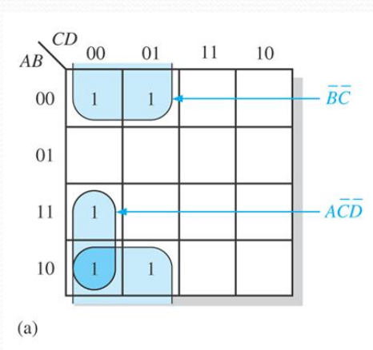
	- **对角线上的格子不相邻。**
- <mark>🔴圈组与读出表达式</mark>
	- 化简 SOP 时圈取值为 1 的格子：
		- 每组数量必须为 \\(2^n\\)，
		- 组应尽可能大、数量尽可能少
		- 所有 1 必须覆盖，允许重叠。
		- **注意：**若某一圈内的所有格子都已同时被其他圈覆盖，该圈不再提供新的覆盖，可删去。
	- 每组中<mark>保持不变的变量</mark>构成乘积项；**各乘积项之和即为化简后的 SOP。**

- <mark>🔴三变量卡诺图：</mark>

| 三变量：\\(A\backslash BC\\) | 00 | 01 | 11 | 10 |
| --- | --- | --- | --- |
| \\(A=0\\) | \\(m_0\\) | \\(m_1\\) | \\(m_3\\) | \\(m_2\\) |
| \\(A=1\\) | \\(m_4\\) | \\(m_5\\) | \\(m_7\\) | \\(m_6\\) |
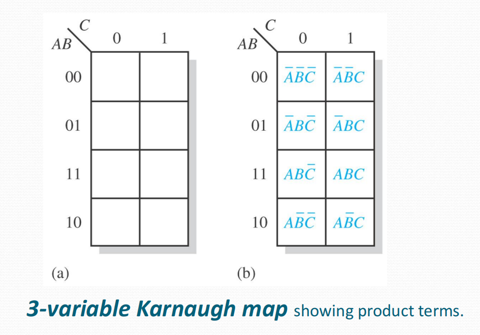
- <mark>🔴四变量卡诺图：\\(AB\\) 为行，\\(CD\\) 为列</mark>

| 四变量：\\(AB\backslash CD\\) | 00 | 01 | 11 | 10 |
| --- | --- | --- | --- |
| 00 | \\(m_0\\) | \\(m_1\\) | \\(m_3\\) | \\(m_2\\) |
| 01 | \\(m_4\\) | \\(m_5\\) | \\(m_7\\) | \\(m_6\\) |
| 11 | \\(m_{12}\\) | \\(m_{13}\\) | \\(m_{15}\\) | \\(m_{14}\\) |
| 10 | \\(m_8\\) | \\(m_9\\) | \\(m_{11}\\) | \\(m_{10}\\) |

- <mark>🔴五变量卡诺图：</mark>

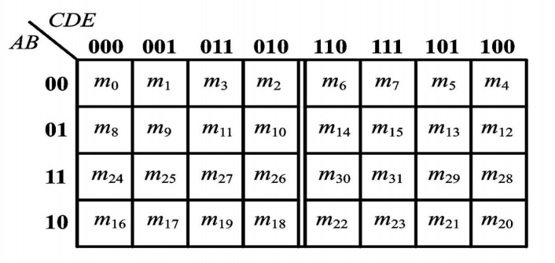

- <mark>🔴格雷码次序</mark>
	- 行、列次序为 \\(00,01,11,10\\)，而非普通二进制顺序 \\(00,01,10,11\\)；**这是让相邻格只改变一个变量的关键。**

- <mark>🔴无关项</mark>
	- 实际系统中永远不会出现、或输出无关紧要的输入组合可标为<mark>无关项</mark>（X）。
	- 无关项可按有利于形成<mark>更大分组</mark>的方式当作 1 使用，也可不使用。
	
- <mark>🔴8421 BCD 示例</mark>
	- 8421 BCD 只使用 \\(0000\\) 到 \\(1001\\)；\\(1010\\) 到 \\(1111\\) 是不允许的输入组合，课件示例可把它们标为无关项，以简化有效 BCD 输入范围内的逻辑。

**[ 例题 ] 用三变量卡诺图化简课件真值表**
对最小项 \\(m_5,m_6,m_7\\)，用三变量卡诺图写出最简 SOP。

> 解
> 1. 由三变量卡诺图定位：\\(m_5\\) 在 \\((A,BC)=(1,01)\\)，\\(m_6\\) 在 \\((1,10)\\)，\\(m_7\\) 在 \\((1,11)\\)。
> 2. 圈 \\(m_5,m_7\\)：两格中 \\(A=1,C=1\\) 保持不变，得到项 \\(AC\\)。
> 3. 圈 \\(m_6,m_7\\)：两格中 \\(A=1,B=1\\) 保持不变，得到项 \\(AB\\)。\\(m_7\\) 允许同时属于两个组。
> 4. 故最简 SOP 为 \\(Y=AC+AB=A(B+C)\\)，与由真值表直接化简的结果一致。

# 第五章：组合逻辑（combinational logic）分析

## 5.1 基本组合逻辑电路

### 5.1.1 与或逻辑（AND-OR）与积之和（SOP）

- <mark>🔴SOP：先与后或的两级实现</mark>
	1. 每个<mark>乘积项</mark>对应一个 AND 门。
	2. 用一个 OR 门对所有乘积项求和。

### 5.1.2 与或非逻辑（AND-OR-Invert）与积之和的反（POS）

- <mark>🔴SOP 与 POS 的实现结构</mark>
	- <mark>SOP</mark>可直接用 AND-OR 结构实现。
	- <mark>POS</mark>可用 AND-OR-Invert 结构实现：先形成各个和项的乘积，再对结果取反。
	- 在 AND-OR 结构最后加<mark>非门</mark>，即可得到 AND-OR-Invert。

### 5.1.3 异或（exclusive-OR, XOR）与同或（exclusive-NOR, XNOR）

- <mark>🔴异或：不同为 1；同或：相同为 1</mark>
| 门电路  | 输出为 \\(1\\) 的条件 | 表达式                                               |
| ---  | ----------- | ---------------------------------------------------- |
| 异或门 |  两个输入不同      | \\(X=A\overline B+\overline A B=A\oplus B\\)             |
| 同或门 |  两个输入相同      | \\(X=AB+\overline A\,\overline B=\overline{A\oplus B}\\)|
	1. <mark>异或门</mark>
	   
	2. <mark>同或门</mark>（两种形式）
	   

### 5.1.4 偶校验的生成与检查

- <mark>🔴偶校验：异或求校验位，再异或检错</mark>
	- 四位数据 \\(A_0,A_1,A_2,A_3\\) 的偶校验位为 ==\\(P=A_0\oplus A_1\oplus A_2\oplus A_3\\)==。
	- 若数据中 1 的个数为奇数，则 ==\\(P=1\\)==，使五位码中 1 的总数变为偶数。

	- 检查时，对四位数据和偶校验位继续异或；<mark>结果为 1 表示发生奇偶校验错误</mark>。

## 5.2 组合逻辑的实现

### 5.2.1 由布尔表达式画逻辑电路

- <mark>🔴由表达式画电路：先内后外，逐层设节点</mark>
	- 按运算层级设置<mark>中间节点</mark>，再按从内到外的顺序连接门电路。
| 表达式                     | 直接实现思路                                   |
| ----------------------- | -------------------------------------- |
| \\(X=AB+CDE\\)              | 先形成 \\(AB\\)、\\(CDE\\)，再经 OR 门相加。                |
| \\(X=AB(C\overline D+EF)\\) | 先得到 \\(C\overline D\\) 与 \\(EF\\)，相加后再与 \\(AB\\) 相与。 |
| \\(X=ABC\overline D+ABEF\\) | 这是上一式展开后的 SOP 形式。                        |
	- 下图均表示同一逻辑；<mark>图 b 更优：级数更少</mark>。
（a）

（b）

### 5.2.2 由真值表写出逻辑表达式

- <mark>🔴真值表到电路：先写最小项，再画 SOP</mark>
	1. 对每一行 \\(X=1\\)：输入为 1 的变量写原变量，输入为 0 的变量写反变量；将所有<mark>最小项相加得到 SOP</mark>。

	2. 通过 SOP 画出逻辑电路。

💡 关键提示

写最小项时，一行真值表必须包含所有输入变量；不要省略该行取 \\(0\\) 的变量的反变量。

### 5.2.3 典型例题

**[ 例题 ] 交通信号灯故障监视器**

输入为红 \\(R\\)、黄 \\(A\\)、绿 \\(G\\)；输出 \\(Z=1\\) 表示故障。正常状态仅为 \\(001\\)、\\(010\\)、\\(100\\)，其余五种状态均为故障。

> 解
> 1. 将五种故障状态写为最小项并化简，得 \\(Z=\overline R\,\overline A\,\overline G+\overline R A G+R\overline A G+RA\overline G+RAG=\overline R\,\overline A\,\overline G+RA+RG+AG\\)。
> 
> 2. 按化简后的表达式画出逻辑电路。
> 

**[ 例题 ] 卡诺图化简**

将原电路的函数用卡诺图化简。

> 解
> 1. 按图将函数填入卡诺图并分组，得到 \\(X=A\overline C\,\overline D+\overline B\,\overline C\\)。
> 2. 注意：<mark>卡诺图上下本质上相连</mark>。
> 

## 5.3 NAND 与 NOR 门的通用性

### 5.3.1  NAND 门搭建其他“门”

- <mark>🔴NAND 是通用门</mark>
	- NAND 逻辑：==\\(X=\overline{AB}\\)==。
| 目标门 | 使用NAND 门实现 | 
| --- | --- |
| NOT | 将 NAND 门的两个输入端相连：\\(\overline{AA}=\overline A\\) | 
| AND | 用非门将 NAND=\\(\overline{AB}\\) 反相：\\(\overline{\overline{AB}}=AB\\) |
| OR | 先产生 \\(\overline A,\overline B\\)，再 NAND：\\(\overline{\overline A\,\overline B}=A+B\\) |
| NOR | 在上述 OR 输出后再反相 |
	1. <mark>NOT</mark>
	   
	2. <mark>AND</mark>
	   
	3. <mark>OR</mark>
	   
	4. <mark>NOR</mark>
	   

### 5.3.2 NOR 门搭建其他“门”

- <mark>🔴NOR 是通用门</mark>
	- NOR 逻辑：==\\(X=\overline{A+B}\\)==。
| 目标门 | 使用NOR 门实现                                                                     | 
| ---- | --------------------------------------------------------------------------- | 
| NOT  | 将 NOR 门的两个输入端相连：\\(\overline{A+A}=\overline A\\)                          |
| OR   | 先得 \\(\overline{A+B}\\)，再用 NOR 作反相：\\(\overline{\overline{A+B}}=A+B\\)              |
| AND  | 先产生 \\(\overline A,\overline B\\)，再 NOR：\\(\overline{\overline A+\overline B}=AB\\) |
| NAND | 在上述 AND 输出后再反相                                                              | 
	1. <mark>NOT</mark>
	   
	2. <mark>OR</mark>
	   
	3. <mark>AND</mark>
	   
	4. <mark>NAND</mark>
	   

- <mark>🔴通用门结论</mark>
	- NAND 与 NOR 都能单独实现<mark>NOT、AND、OR</mark>，因此都是<mark>通用逻辑门</mark>。

## 5.4 仅用 NAND / NOR 门实现组合逻辑

### 5.4.1 用 NAND 门实现 SOP

- <mark>🔴NAND 实现 SOP：先反相乘积，再作与非</mark>
	1. 对 \\(X=AB+CD\\)，有 \\(X=\overline{\overline{AB}\cdot\overline{CD}}=AB+CD\\)。
	2. 第一级 NAND 门产生 \\(\overline{AB}\\)、\\(\overline{CD}\\)；最后一级依据德摩根定律得到 OR 运算。

### 5.4.2 用 NOR 门实现 POS

- <mark>🔴NOR 实现 POS：先反相和项，再作或非</mark>
	1. 对 \\(X=(A+B)(C+D)\\)，有 \\(X=\overline{\overline{A+B}+\overline{C+D}}=(A+B)(C+D)\\)。
	2. 第一级 NOR 门产生 \\(\overline{A+B}\\)、\\(\overline{C+D}\\)；最后一级得到 AND 运算。

### 5.4.3 双重符号与气泡抵消

- <mark>🔴气泡抵消：相邻反相小圆圈可相消</mark>
	- 导线相连的两个<mark>气泡（反相小圆圈）</mark>可相互抵消。

	- 利用双重符号，可按等效的 AND/OR 功能逐级读电路，不必反复展开反相符号。
	1. 原门电路逻辑
	   
	2. 每个或非门实际扮演的门
	   
	3. 将后级或非门转为非与门后，气泡相消
	   

💡 关键提示

读多级 NAND/NOR 电路时，先标出每一级输出；若相邻连接端的两个气泡相对，则先抵消，再判断该级等效为 AND 还是 OR。

## 5.5 脉冲波形输入下的逻辑电路分析

### 5.5.1 四类基本门的时序判定

- <mark>🔴四类基本门：由输出条件判波形</mark>
| 门 | 输出为高电平的条件 | 输出为低电平的条件 |
| --- | --- | --- |
| AND | 所有输入同时为高 | 至少一个输入为低 |
| OR | 至少一个输入为高 | 所有输入均为低 |
| NAND | 至少一个输入为低 | 所有输入同时为高 |
| NOR | 所有输入均为低 | 至少一个输入为高 |

### 5.5.2 通用分析步骤

- <mark>🔴波形分析：节点 → 分段 → 推演 → 复核</mark>
	1. 按信号流向为各<mark>中间节点</mark>命名并写出表达式。
	2. 以所有输入的<mark>跳变时刻</mark>划分时间区间。
	3. 从最前级门开始，逐区间画出中间节点波形。
	4. 最后画输出波形，并用总表达式复核。
	- 可用<mark>布尔化简、气泡化简、波特图化简</mark>简化表达式。

**[ 例题 ] NAND 输出波形**

根据图示输入波形，分析 NAND 电路的输出波形。

> 解
> 1. 中间节点为 \\(Y=B+C\\)，输出为 \\(X=\overline{A(B+C)}=\overline A+\overline B\,\overline C\\)。
> 2. 因而仅当 \\(A=1\\) 且 \\(B+C=1\\) 时，\\(X=0\\)；其余时段 \\(X=1\\)。
> 

## 5.6 本章复习主线

📋 本节小结

1. **表达式实现：** SOP 对应 AND-OR；真值表中所有 \\(X=1\\) 的行写成最小项后求和。
2. **设计流程：** 逻辑抽象 → 定义输入/输出 → 真值表 → 表达式 → 化简 → 画电路。
3. **通用门：** NAND 与 NOR 都能单独构成 NOT、AND、OR，因此可实现任意组合逻辑。
4. **门图读式：** NAND 适合实现 SOP，NOR 适合实现 POS；双重符号和气泡抵消可减少反相符号干扰。
5. **时序分析：** 先画中间节点，再画最终输出；每次跳变都按各门的逻辑条件逐区间判断。

# 第六章：组合逻辑功能
## 6.1 基本加法器（adder）
### 6.1.1 半加器（Half-Adder）

<mark>🔴半加器</mark>

- 半加器只将两个 1 位二进制数相加，<mark>不接收低位进位</mark>。
- 二进制加法规则为：\\(0+0=0\\)，\\(0+1=1\\)，\\(1+0=1\\)，\\(1+1=10\\)。
- 输入为加数 \\(A\\)、\\(B\\)；输出为<mark>和 \\(\Sigma\\)</mark>与<mark>进位 \\(C_{out}\\)</mark>。
- 和由异或门实现：==\\(\Sigma=A\overline B+\overline A B=A\oplus B\\)<mark>；进位由与门实现：</mark>\\(C_{out}=AB\\)==。

| \\(A\\) | \\(B\\) | \\(C_{out}\\) | \\(\Sigma\\) |
| --- | --- | --- | --- |
| 0 | 0 | 0 | 0 |
| 0 | 1 | 0 | 1 |
| 1 | 0 | 0 | 1 |
| 1 | 1 | 1 | 0 |

### 6.1.2 全加器（Full-Adder）

<mark>🔴全加器：多一个低位进位输入</mark>

- 输入为加数 \\(A\\)、\\(B\\) 与低位进位<mark>\\(C_{in}\\)</mark>；输出为和 \\(\Sigma\\) 与进位 \\(C_{out}\\)。
	- 和的积之和形式为 \\(\Sigma=\overline A\,\overline B C_{in}+\overline A B\overline{C_{in}}+A\overline B\,\overline{C_{in}}+ABC_{in}=A\oplus B\oplus C_{in}\\)。
	- 进位的积之和形式为 \\(C_{out}=\overline A B C_{in}+A\overline B C_{in}+AB\overline{C_{in}}+ABC_{in}=AB+(A\oplus B)C_{in}\\)。
- 结构为<mark>两个半加器加一个或门</mark>：第一半加器处理 \\(A,B\\)，第二半加器处理其和与 \\(C_{in}\\)，两路半加器进位经或门得到 \\(C_{out}\\)。

| \\(A\\) | \\(B\\) | \\(C_{in}\\) | \\(C_{out}\\) | \\(\Sigma\\) |
| --- | --- | --- | --- | --- |
| 0 | 0 | 0 | 0 | 0 |
| 0 | 0 | 1 | 0 | 1 |
| 0 | 1 | 0 | 0 | 1 |
| 0 | 1 | 1 | 1 | 0 |
| 1 | 0 | 0 | 0 | 1 |
| 1 | 0 | 1 | 1 | 0 |
| 1 | 1 | 0 | 1 | 0 |
| 1 | 1 | 1 | 1 | 1 |

**[ 例题 ] 全加器逐级求值**
输入 \\(A=1\\)、\\(B=0\\)、\\(C_{in}=1\\)，确定中间与最终输出。

> 解
> 1. 第一半加器输入 \\(1,0\\)，得和 \\(1\\)、进位 \\(0\\)。
> 2. 第二半加器输入 \\(1,1\\)，得和 \\(0\\)、进位 \\(1\\)。
> 3. 或门综合两进位，最终 ==\\(C_{out}=1,\ \Sigma=0\\)==。

## 6.2 并行二进制加法器（parallel binary adder）

<mark>🔴并行加法器：全加器逐位级联</mark>

- 加 1 位以上的二进制数需级联多个全加器：每级<mark>进位输出接高一位进位输入</mark>。
- 2 位并行加法器由两个全加器构成，最低位进位输入一般接地，即 ==\\(C_0=0\\)==。
- 4 位并行加法器从最低位（LSB）向最高位（MSB）依次传递 \\(C_1,C_2,C_3\\)，最终输出为 \\(C_4\\)；各级分别输出 \\(\Sigma_1\\) 至 \\(\Sigma_4\\)。

**[ 例题 ] 3 位并行加法器**
\\(101+011\\)，标出中间进位。

> 解
> 1. 第 0 位：\\(1+1\\) 得 \\(\Sigma_0=0\\)、\\(C_1=1\\)。
> 2. 第 1 位：\\(0+1+C_1\\) 得 \\(\Sigma_1=0\\)、\\(C_2=1\\)。
> 3. 第 2 位：\\(1+0+C_2\\) 得 \\(\Sigma_2=0\\)、\\(C_3=1\\)。
> 4. 因而 \\(\Sigma_2\Sigma_1\Sigma_0=000\\)，\\(C_{out}=C_3=1\\)，结果为 <mark>\\(1000\\)</mark>。

### 6.2.1 集成加法器 74LS283

<mark>🔴74LS283：4 位并行加法器，可级联扩展</mark>

- <mark>74LS283</mark>的逻辑符号有两组 4 位输入 \\(A_1\sim A_4\\)、\\(B_1\sim B_4\\)，一组 4 位和输出 \\(\Sigma_1\sim\Sigma_4\\)，并具有输入进位 \\(C_0\\) 和输出进位 \\(C_4\\)。
- 课件给出的引脚对应关系如下；其余连线关系应以逻辑符号和实物引脚图共同核对。

| 功能 | 端子／引脚号 |
| --- | --- |
| 电源 | \\(V_{CC}\\)：16；GND：8 |
| 初始／最高位进位 | \\(C_0\\)：7；\\(C_4\\)：9 |
| \\(A_1,A_2,A_3,A_4\\) | 5，3，14，12 |
| \\(B_1,B_2,B_3,B_4\\) | 6，2，15，11 |
| \\(\Sigma_1,\Sigma_2,\Sigma_3,\Sigma_4\\) | 4，1，13，10 |

- 两片 74LS283 可级联构成 8 位加法器：<mark>低位片 \\(C_4\\) 接高位片 \\(C_0\\)</mark>。
- 四片 4 位加法器按相同方向级联，可构成 16 位加法器；最低位片的 \\(C_0\\) 可接地。

**[ 例题 ] 8 位级联求和**
\\(A_8\cdots A_1=10111001\\)，\\(B_8\cdots B_1=10011110\\)，\\(C_0=0\\)。

> 解
> 1. 逐位相加得 \\(S_8\cdots S_1=01010111\\)，\\(C_{out}=1\\)。
> 2. 因而结果为 ==\\(1\,01010111_2=343\\)==，与 \\(185+158=343\\) 一致。

**[ 例题 ] 六人投票系统**
课件以六个 YES/NO 开关为例，使用全加器和并行二进制加法器分别统计赞成票与反对票，并将结果显示在七段数码管上。

> 解
> 1. 上方的 YES logic 与下方的 NO logic 分别由全加器和 4 位并行加法器组成，得到两类票数的二进制计数结果。
> 2. 两路 4 位和输出各接一个 BCD-七段译码器（BCD-to-7-segment decoder），再驱动对应的七段显示器，分别显示 YES 与 NO 的计数。
> 3. 课件图注要求：全加器未使用的输入端经电阻接地，避免输入悬空。

## 6.3 纹波进位（ripple carry，也称异步进位）与超前进位（carry look-ahead）加法器

<mark>🔴纹波进位（异步进位）与超前进位</mark>

- <mark>纹波进位加法器（ripple carry adder，异步进位加法器）</mark>：
	- 每个全加器的进位输出接到下一高位级的进位输入，进位逐级传递，因此存在<mark>时间延迟（time delay）</mark>。
	- 课件给出的 4 位最坏情况中，进位需依次穿过 4 级全加器；每级传播延迟为 \\(8\ \text{ns}\\)，总延迟为<mark>\\(32\ \text{ns}\\)</mark>。
- <mark>超前进位加法器（look-ahead carry adder，超前进位加法器）</mark>
	- 预先估计每一级的输出进位，并根据输入通过<mark>进位产生</mark>或<mark>进位传递</mark>得到该输出进位。

<mark>🔴超前进位的生成、传递与展开规律</mark>

- <mark>进位产生（carry generation）</mark>：\\(C_g=AB\\)（两位同为1的时候进位）
- <mark>进位传递（carry propagation）</mark>：\\(C_p=A+B\\)（有一位为1，再与上上级进位）
- 每级输出进位满足 ==\\(C_{out,i}=C_{g,i}+C_{p,i}C_{in,i}\\)==。
- 对 4 位加法器，\\(C_{g,i}=A_iB_i\\)、\\(C_{p,i}=A_i+B_i\\)；展开后：
  - \\(C_{out1}=C_{g1}+C_{p1}C_{in1}\\)。
  - \\(C_{out2}=C_{g2}+C_{p2}C_{g1}+C_{p2}C_{p1}C_{in1}\\)。
  - \\(C_{out3}=C_{g3}+C_{p3}C_{g2}+C_{p3}C_{p2}C_{g1}+C_{p3}C_{p2}C_{p1}C_{in1}\\)。
  - \\(C_{out4}=C_{g4}+C_{p4}C_{g3}+C_{p4}C_{p3}C_{g2}+C_{p4}C_{p3}C_{p2}C_{g1}+C_{p4}C_{p3}C_{p2}C_{p1}C_{in1}\\)。
- 因而每一级输出进位只依赖<mark>初始进位 \\(C_{in1}\\)、本级的 \\(C_g,C_p\\) 与所有低级的 \\(C_g,C_p\\)</mark>；不必让进位在串行链中逐级等待。

## 6.4 比较器（comparator）

- <mark>🔴相等比较：逐位同或，再相与</mark>
 
	- 比较器判断两个数是否相等；相等比较用<mark>同或门逐位判等后再相与</mark>。
	- 应用：计算机的<mark>标识符地址比较</mark>。

**[ 例题 ] 跟踪比较器电平**
分别比较输入 \\(10\\) 与 \\(10\\)、\\(11\\) 与 \\(10\\)。

> 解
> 1. \\(10\\) 与 \\(10\\)：两同或门输出均为 1，与门输出 1，判<mark>相等</mark>。
> 2. \\(11\\) 与 \\(10\\)：\\(A_0=1,B_0=0\\) 的同或门输出 0，与门输出 0，判<mark>不等</mark>。

### 6.4.1    4 位数值比较大小

- <mark>🔴数值比较：从最高位向低位比较</mark>

	- 若 \\(A_3=1,B_3=0\\) 则 \\(A\\) 大；若 \\(A_3=0,B_3=1\\) 则 \\(A\\) 小；若 \\(A_3=B_3\\) 则继续比较次低位。
	- <mark>74HC85</mark>为 4 位数值比较器；两片可级联为 8 位比较器，低位片比较输出接高位片级联输入。
	
	- 真值表：（ <mark>\\(X\\)</mark>表示无关项）
	

电路逻辑：
比较 \\(A_3A_2A_1A_0\\) 与 \\(B_3B_2B_1B_0\\)（\\(\overline{A\oplus B}\\) 为同或，即对应位相等）：

$$Y_{(A<B)}=\overline{A}_3B_3+\overline{A_3\oplus B_3}\,\overline{A}_2B_2+\overline{A_3\oplus B_3}\,\overline{A_2\oplus B_2}\,\overline{A}_1B_1+\overline{A_3\oplus B_3}\,\overline{A_2\oplus B_2}\,\overline{A_1\oplus B_1}\,\overline{A}_0B_0$$

$$Y_{(A=B)}=\overline{(A_3\oplus B_3)(A_2\oplus B_2)(A_1\oplus B_1)(A_0\oplus B_0)}$$

$$Y_{(A>B)}=\overline{(Y_{(A<B)}+Y_{(A=B)})}$$

### 6.4.2 74HC85 内部电路分析（高两位）

电路实现：

<mark>🔴74HC85-1 内部电路分析：先比较高位</mark>

- 内部电路含<mark>4 个同或门</mark>和<mark>2 个负与门</mark>。本图先分析最高两位 \\(A_3/B_3\\)、\\(A_2/B_2\\) 的比较路径。
- <mark>当 \\(A_3\\) 与 \\(B_3\\) 不相等时</mark>：
	- 同或门 1 输出为 0，将与门 \\(b\sim k\\) 封锁；这些与门的输出均为 0，故输出端 \\(O_{A=B}=0\\)。
	- 若 \\(A_3>B_3\\)，与门 \\(a\\) 输出为 0，负与门 1 输出为 1，指示 \\(A>B\\)。
	- 若 \\(A_3<B_3\\)，与门 \\(l\\) 输出为 0，负与门 2 输出为 1，指示 \\(A<B\\)。
- <mark>当 \\(A_3\\) 与 \\(B_3\\) 相等时</mark>：
	- 同或门 1 输出为 1；与门 \\(a,l\\) 输出为 0，继续比较 \\(A_2\\) 与 \\(B_2\\)。
	- 若 \\(A_2\\) 与 \\(B_2\\) 不相等，同或门 2 输出为 0，将与门 \\(c\sim j\\) 封锁；这些与门的输出均为 0，故 \\(O_{A=B}=0\\)。
	- 若 \\(A_2>B_2\\)，与门 \\(b\\) 输出为 0，负与门 1 输出为 1，指示 \\(A>B\\)；若 \\(A_2<B_2\\)，与门 \\(k\\) 输出为 0，负与门 2 输出为 1，指示 \\(A<B\\)。

## 6.5 译码器（decoder）

- <mark>🔴译码器：</mark>
	- 指定码出现，指定输出有效
	- 译码器检测输入端是否出现指定的位组合，并以规定输出电平指示该码出现。
	- 应用：计算机读取指令时的<mark>指令译码</mark>。

### 6.5.1 基本二进制译码

- <mark>🔴译码门的选择由有效电平决定</mark>
	- 译 \\(1001\\) 且高有效：用与门组合 \\(A_3\\)、\\(\overline{A_2}\\)、\\(\overline{A_1}\\)、\\(A_0\\)。
	
	- <mark>高有效输出用与门，低有效输出用与非门</mark>。

- <mark>🔴4 线-16 线译码器</mark>
	- 对每个四位输入码，只对应 16 个输出中的一个。若输出低有效，则被选中的一路为 0，其余 15 路为 1；这就是 1-of-16 的含义。
	- 课件的另一个高有效译码例子为 \\(1011\\)：\\(Y=A_3\overline{A_2}A_1A_0\\)。输入不等于该码时，至少有一个与项为 0，故 \\(Y=0\\)。
	- 低有效 4 线-16 线译码的完整输入—输出对应如下（表中未列出的 15 路均为 1）：

| 十进制值 | \\(A_3A_2A_1A_0\\) | 被选中的低有效输出 |
| --- | --- | --- |
| 0 | 0000 | \\(\overline{Y_0}=0\\) |
| 1 | 0001 | \\(\overline{Y_1}=0\\) |
| 2 | 0010 | \\(\overline{Y_2}=0\\) |
| 3 | 0011 | \\(\overline{Y_3}=0\\) |
| 4 | 0100 | \\(\overline{Y_4}=0\\) |
| 5 | 0101 | \\(\overline{Y_5}=0\\) |
| 6 | 0110 | \\(\overline{Y_6}=0\\) |
| 7 | 0111 | \\(\overline{Y_7}=0\\) |
| 8 | 1000 | \\(\overline{Y_8}=0\\) |
| 9 | 1001 | \\(\overline{Y_9}=0\\) |
| 10 | 1010 | \\(\overline{Y_{10}}=0\\) |
| 11 | 1011 | \\(\overline{Y_{11}}=0\\) |
| 12 | 1100 | \\(\overline{Y_{12}}=0\\) |
| 13 | 1101 | \\(\overline{Y_{13}}=0\\) |
| 14 | 1110 | \\(\overline{Y_{14}}=0\\) |
| 15 | 1111 | \\(\overline{Y_{15}}=0\\) |

### 6.5.2 集成译码器 74HC154

- <mark>🔴74HC154：</mark>
 
	- 为 1-of-16 译码器（右侧16个引脚，选择一个输出0）
	- 左侧四输入，输入二进制 0~15；输出：对应的输出引脚设为0.
	- 使能位：接0时正常执行功能；接1时输出全为1(不工作)。
	- 两个片选端 \\(\overline{CS_1}\\)、\\(\overline{CS_2}\\) 都为低电平时才使能；任一片选端为高电平，全部低有效输出都为 1。
	- 地址输入 \\(A_0,A_1,A_2,A_3\\) 的权值依次为 \\(1,2,4,8\\)；使能后，与输入数值相同编号的 \\(\overline{Y_n}\\) 被选为 0。
- 用两片译 5 位数时，最高位<mark>\\(A_4\\) 接片选输入</mark>；
	
	- \\(A_4\\) 接在使能引脚，然后用反相器接在右侧芯片的使能引脚。（这样两个芯片实际只有一个是处于工作状态）
	- 输入 \\(10110\\) 时，\\(A_4=1\\)，左侧芯片不使能，右侧芯片正常工作。右侧芯片工作的时候，实际只计算前4位，第五位上的“16”，直接有引脚定义偏移“16”弥补。输出为 22。
- 应用：用 4 条地址线作计算机 I/O 端口地址译码。

### 6.5.3 BCD-十进制译码与七段显示

- <mark>🔴BCD 译码</mark>
	- BCD-十进制译码将 8421 码译成 \\(Y_0\sim Y_9\\) 十个十进制指示之一；
		- 例如 <mark>74HC42 的 \\(Y_0\sim Y_9\\) 为低电平有效</mark>。
	- BCD-七段译码将 8421 BCD 码转换为 \\(Y_a\sim Y_g\\) 七路段控制信号；
		- 例如输入 \\(1001\\) 时显示 \\(9\\)。
		- **74LS47 低电平有效，74LS48 高电平有效**；应按数码管的共阳/共阴结构选择。
	
	- 真值表：
		- \\(10\sim15\\) 为<mark>无效 BCD 输入</mark>，化简时可作无关项处理。
	

- <mark>🔴七段显示的结构与段码</mark>

	- 七个笔画依次为：\\(a\\)（上）、\\(b\\)（右上）、\\(c\\)（右下）、\\(d\\)（下）、\\(e\\)（左下）、\\(f\\)（左上）、\\(g\\)（中）；DP 为小数点。
	- 共阳共阴极性：
		- <mark>共阳极</mark>数码管把各 LED 的阳极接公共端 COM，段线接阴极；段线为低电平时点亮，适配低电平有效的 74LS47。
		- <mark>共阴极</mark>数码管把各 LED 的阴极接公共端 COM，段线接阳极；段线为高电平时点亮，适配高电平有效的 74LS48。
	- 课件的 BCD-七段真值表采用高电平点亮：\\(Y_x=1\\) 表示对应段亮；其中 \\(0\sim9\\) 给出十进制字形，\\(10\sim15\\) 仅供逻辑化简时作为无关项处理。表中 \\(1011\\) 的段码为 <mark>0011001</mark>。

| 数字 | \\(A_3A_2A_1A_0\\) | \\(Y_aY_bY_cY_dY_eY_fY_g\\) |
| --- | --- | --- |
| 0 | 0000 | 1111110 |
| 1 | 0001 | 0110000 |
| 2 | 0010 | 1101101 |
| 3 | 0011 | 1111001 |
| 4 | 0100 | 0110011 |
| 5 | 0101 | 1011011 |
| 6 | 0110 | 0011111 |
| 7 | 0111 | 1110000 |
| 8 | 1000 | 1111111 |
| 9 | 1001 | 1110011 |
| 10 | 1010 | 0001101 |
| 11 | 1011 | 0011001 |
| 12 | 1100 | 0100011 |
| 13 | 1101 | 1001011 |
| 14 | 1110 | 0001111 |
| 15 | 1111 | 0000000 |

- <mark>🔴74LS47/74LS48 与附加控制</mark>
	- 74LS47 是 BCD-七段译码/驱动器，BCD 输入 \\(A,B,C,D\\) 的权值依次为 \\(1,2,4,8\\)，引脚为 7、1、2、6；段输出 \\(a,b,c,d,e,f,g\\) 的引脚为 13、12、11、10、9、15、14。
	- 74LS47 的 \\(\overline{LT}\\)（试灯，3 脚）、\\(\overline{RBI}\\)（灭零输入，5 脚）、\\(\overline{BI/RBO}\\)（灭灯输入/灭零输出，4 脚）均为低有效；16 脚接 \\(V_{CC}\\)、8 脚接地。
	- 74LS48 内部用 \\(G_5\sim G_{12}\\) 生成中间逻辑量，再由 \\(G_{13}\sim G_{19}\\) 形成 \\(Y_a\sim Y_g\\)；试灯、灭零、灭灯会覆盖正常的 BCD 译码结果。
	- <mark>试灯</mark>：\\(\overline{LT}=0\\) 时，74LS48 的 \\(Y_a\sim Y_g\\) 全为 1，七段全亮，用于检查各段和连线。
	- <mark>灭零</mark>：当 \\(A_3A_2A_1A_0=0000\\) 且 \\(\overline{RBI}=0\\) 时，\\(Y_a\sim Y_g\\) 全为 0，数字 \\(0\\) 不显示；同时 \\(\overline{RBO}=0\\) 可传给相邻位的 \\(\overline{RBI}\\)。
	- 将一位的 RBO 接到下一位的 RBI，可按连接方向逐位传递“当前仍为零”的状态，得到<mark>前导零抑制</mark>或<mark>尾随零抑制</mark>；课件示例分别为 `0039→39`、`5.700→5.7`。
	- <mark>灭灯</mark>：从外部把 \\(\overline{BI}=0\\) 加到 BI/RBO 端时，\\(Y_a\sim Y_g\\) 全为 0，不论 BCD 输入为何均熄灭。

**[ 例题 ] e 段卡诺图化简**
先由 BCD-七段真值表为每一段建立卡诺图，\\(10\sim15\\) 可作无关项；对 0 圈组后再取反，和直接对 1 圈组化简得到的输出式等价。

> 解
> 1. 对 1 圈组得 \\(Y_e=A_1\overline{A_0}+\overline{A_2}\,\overline{A_0}\\)。
> 2. 对 0 圈组得 \\(Y_e=\overline{(A_0+A_2\overline{A_1})}\\)。
> 3. 两式化简后<mark>等价</mark>。

## 6.6 编码器（encoder）

- <mark>🔴编码器：译码的反功能</mark>
	- 某输入端出现代表数字的有效电平，即转为<mark>编码输出</mark>。
	- 应用：将助记指令转换成计算机可识别的<mark>机器码指令</mark>。

### 6.6.1 十进制-BCD 编码器

- <mark>🔴十进制-BCD 编码：</mark>
	- 十进制数 \\(3\\) 的编码过程：顶部两或门输出 1（见课件红线），故输出为 <mark>\\(0011\\)</mark>。
	

- 若十根十进制输入线中只有 \\(I_n\\) 有效，则输出为数字 \\(n\\) 的 8421 BCD 码。逻辑图中每个 BCD 位由所有“该位应为 1”的输入线相或得到：
	- \\(A_0=I_1+I_3+I_5+I_7+I_9\\)；
	- \\(A_1=I_2+I_3+I_6+I_7\\)。
	- \\(A_2=I_4+I_5+I_6+I_7\\)；
	- \\(A_3=I_8+I_9\\)。
	
	- 这种普通编码器默认<mark>同一时刻仅一根输入线有效</mark>；多根输入同时有效时，或门输出不再对应唯一十进制数，这正是优先编码器要解决的问题。

### 6.6.2 优先编码器（priority encoder）

- <mark>🔴优先编码器：高优先级输入优先响应</mark>
	- <mark>74HC147</mark>为十进制-BCD 优先编码器，HPRI 表示最高位输入优先。
	
	- <mark>74LS148</mark>为 8 线-3 线编码器：EI 低有效；EO 在 EI 低且无有效输入时为低；GS 在 EI 低且有输入有效时为低。
	
		- **可用 74LS148 加外部逻辑构成<mark>16 线-4 线</mark>编码器**。将 \\(I_8\sim I_{15}\\) 接到高优先级 74LS148、\\(I_0\sim I_7\\) 接到低优先级芯片；高组的 EO 接低组 EI。高组无有效输入时 EO 为低并使能低组，高组一旦有有效输入便禁止低组，因此整体仍保持高编号优先。> 	- 16 线-4 线扩展时，将 \\(I_8\sim I_{15}\\) 接到高优先级 74LS148、\\(I_0\sim I_7\\) 接到低优先级芯片；高组的 EO 接低组 EI。高组无有效输入时 EO 为低并使能低组，高组一旦有有效输入便禁止低组，因此整体仍保持高编号优先。
		
	- <mark>键盘编码器</mark>可用 HPRI/BCD 型 74HC147；输入输出<mark>全低有效</mark>、输出为反码，\\(X\\) 表示无关项。
	
		- 键盘电路中，各按键经电阻上拉；按下某键把相应输入拉低。74HC147 输出该键的 BCD==反码==；\\(0\\) 键不必接入编码器输入，但可单独供其他电路检测“有键按下”。

| \\(\overline{EI}\\) | 最高优先的 \\(0\\) 输入 | \\(\overline{Y_2}\,\overline{Y_1}\,\overline{Y_0}\\) | \\(\overline{EO}\\) \\(\overline{GS}\\) |
| --- | --- | --- | --- |
| 1 | 无关 | 111 | 1 1 |
| 0 | 无（全为 1） | 111 | 0 1 |
| 0 | \\(\overline{I_7}\\) | 000 | 1 0 |
| 0 | \\(\overline{I_6}\\) | 001 | 1 0 |
| 0 | \\(\overline{I_5}\\) | 010 | 1 0 |
| 0 | \\(\overline{I_4}\\) | 011 | 1 0 |
| 0 | \\(\overline{I_3}\\) | 100 | 1 0 |
| 0 | \\(\overline{I_2}\\) | 101 | 1 0 |
| 0 | \\(\overline{I_1}\\) | 110 | 1 0 |
| 0 | \\(\overline{I_0}\\) | 111 | 1 0 |

## 6.7 多路选择器（multiplexer，数据选择器）

- <mark>🔴多路选择器：</mark>
	- 多路选择器将多路数字信息选一路送到单线上传输。
	- 4 选 1 输出为 \\(Y=\overline{S_1}\,\overline{S_0}D_0+\overline{S_1}S_0D_1+S_1\overline{S_0}D_2+S_1S_0D_3\\)。
	
	- 选择码 \\(S_1S_0=00,01,10,11\\) 时，输出依次跟随 \\(D_0,D_1,D_2,D_3\\)；在波形图的每一选通区间内，未选通数据的变化不影响 \\(Y\\)。
	
- <mark>74LS151</mark>
	-  8 输入数据选择器，\\(\overline{EN}=0\\) 时使能，\\(S_2S_1S_0\\) 选定 \\(D_0\sim D_7\\)，并同时给出 \\(Y\\) 与 \\(\overline{Y}\\) 两个互补输出。

 
	- 两片 74LS151 可构成<mark>16 选 1</mark>：\\(S_0\sim S_2\\) 同时接两片，\\(S_3\\) 与其反相值分别控制两片的低有效使能端，使任一时刻只有一片工作，再组合两片输出。
	
- <mark>74HC157</mark>
	- 在一片芯片中封装四个相互独立的 2 选 1 多路选择器；四路共用选择端和低有效使能端，每一路在 \\(nA/nB\\) 中选择一路输出 \\(nY\\)。

	- 七段显示复用例中，74LS157 在低/高选择电平下轮流送出两组 BCD 码到同一 BCD-七段译码器；两位数码管共用段线，由低有效位选端轮流使能对应的一位，利用视觉暂留同时显示两位数。
	

**[ 例题 ] 用 74LS151 实现 3 变量函数**

真值表给出 \\(Y\\) 在 \\(001\\)、\\(011\\)、\\(101\\)、\\(110\\) 时为 \\(1\\)，即 \\(Y=\overline{A_2}\,\overline{A_1}A_0+\overline{A_2}A_1A_0+A_2\overline{A_1}A_0+A_2A_1\overline{A_0}\\)。

> 解
> 1. 令 \\(A_2A_1A_0\to S_2S_1S_0\\)，按最小项号置数据端。

| \\(S_2S_1S_0\\) | 最小项   | \\(Y\\) | \\(D_i\\) |
| ----------- | ----- | --- | ----- |
| 000         | \\(m_0\\) | 0   | 0     |
| 001         | \\(m_1\\) | 1   | 1     |
| 010         | \\(m_2\\) | 0   | 0     |
| 011         | \\(m_3\\) | 1   | 1     |
| 100         | \\(m_4\\) | 0   | 0     |
| 101         | \\(m_5\\) | 1   | 1     |
| 110         | \\(m_6\\) | 1   | 1     |
| 111         | \\(m_7\\) | 0   | 0     |
> 2. 因此<mark>\\(D_1,D_3,D_5,D_6\\) 接高电平</mark>，其余数据端接低电平。

💡 关键提示

出现该最小项的 \\(D_i\\) 接高电平 \\(1\\)，不出现的接地 \\(0\\)；选择线直接接函数变量。

## 6.8 数据分配器（demultiplexer）

- <mark>🔴数据分配器：选择线决定数据送往哪一路</mark>

	- 数据分配器是多路选择器的<mark>反功能</mark>：将单线数字信息分发到指定输出线。
- 1 线-4 线分配器：数据输入与选择线经与门阵列产生 \\(D_0\sim D_3\\)。
	- 只有被选中的输出线跟随数据输入；其余输出保持 0。
	
- 1 线-8 线分配器：选择 \\(A,B,C\\)，输入数据 \\(D\\)，各通道输出即带 \\(D\\) 的最小项。

	- | 通道 | \\(ABC\\) | 输出 |
| --- | --- | --- |
| \\(F_0\\) | 000 | \\(\overline{A}\,\overline{B}\,\overline{C}D\\) |
| \\(F_1\\) | 001 | \\(\overline{A}\,\overline{B}CD\\) |
| \\(F_2\\) | 010 | \\(\overline{A}B\overline{C}D\\) |
| \\(F_3\\) | 011 | \\(\overline{A}BCD\\) |
| \\(F_4\\) | 100 | \\(A\overline{B}\,\overline{C}D\\) |
| \\(F_5\\) | 101 | \\(A\overline{B}CD\\) |
| \\(F_6\\) | 110 | \\(AB\overline{C}D\\) |
| \\(F_7\\) | 111 | \\(ABCD\\) |

**[ 例题 ] 用分配器实现任意 4 变量函数**

把 \\(A,B,C\\) 作通道选择、\\(D\\) 作数据输入时，8 路输出正好是含 \\(D\\) 的 8 个最小项；课件据此提出如何实现任意 4 变量函数。

> 解
> 1. 令 \\(D=1\\) 时，分配器退化为 3 线-8 线译码器：8 路输出对应 \\(A,B,C\\) 的 8 个最小项，可经或门实现任意<mark>三变量</mark>函数。
> 2. 对一般的 \\(F(A,B,C,D)\\)，本分配器的一组输出提供各个“\\(\cdots D\\)”最小项；还需用 \\(\overline D\\) 作为另一数据输入（或采用另一条等效分配路径）产生“\\(\cdots\overline D\\)”最小项，再把目标函数需要的项或起来。

## 6.9 奇偶发生器（parity generator）/校验器（parity checker）

- <mark>🔴奇偶发生与校验：</mark>
	- 奇偶校验：给信息位附加校验位，使 1 的总数为<mark>偶数或奇数</mark>。
	- 模 2 和不计进位：<mark>偶数个 1 之和为 0，奇数个 1 之和为 1</mark>。
		
		-  4 位模 2 和可用 3 个异或门级联；
	- <mark>74LS280</mark>为 9 位奇偶发生器/校验器。
	
	- 简单数据传输系统——带错误检测（奇偶校验）
	
		- 发送端用 \\(\Sigma Odd\\) 产生<mark>偶校验位</mark> \\(P\\)：信息位中 1 的个数为奇数时 \\(P=1\\)，为偶数时 \\(P=0\\)，从而使“信息位加 \\(P\\)”的 1 的总数为偶数。
		- 接收端把 \\(D_0\sim D_6\\) 与 \\(P\\) 一起送入 74LS280；无误时得到偶校验，单个比特翻转会改变总奇偶性，错误门输出 `Error = 1`。
		- 将 \\(D_0\sim D_6\\) 与 \\(P\\) 经多路选择器串行送入四线传输链路，并由数据分配器恢复各位；波形图在第二组数据中示出“发送 0、接收为 1”后错误信号置高。

## 6.10 竞争与冒险（race and hazard）

<mark>🔴竞争与冒险：由路径延迟差造成的窄尖峰</mark>

- <mark>竞争（race）</mark>：两个输入信号同时向相反逻辑电平跳变，即一个由 \\(1\to0\\)、另一个由 \\(0\to1\\)。
- <mark>竞争与冒险（race and hazard）</mark>：竞争发生后，因信号经过的传输路径及延迟不同，输出端可能出现极窄的尖峰脉冲；**这种尖峰本质上是噪声，可能使后级电路误动作。**

- 2 线—4 线译码器在两个输入同时改变时，就可能出现这种尖峰。

- 检查方法：若变量 \\(A\\) 经两条不同路径分别形成 \\(A\\) 与 \\(\overline A\\) 并共同影响输出，则当 \\(A\\) 突变时要检查是否出现
	- \\(Y=A+\overline A\\)；
	- \\(Y=A\overline A\\)。
	**能化为上述形式，说明存在竞争—冒险的可能。**

**[ 例题 ] 判断竞争与冒险**

已知任一瞬间只允许一个输入变量改变，判断下列电路在给定条件下是否可能出现竞争与冒险：

$$
Y_1=AB+\overline AC,\qquad Y_2=(A+B)(\overline B+C)
$$

解
1. 对 \\(Y_1\\)，令 \\(B=C=1\\)，得 \\(Y_1=A+\overline A\\)；\\(A\\) 的正、反两路到达时间可能不同，存在竞争与冒险。
2. 对 \\(Y_2\\)，令 \\(A=C=0\\)，得 \\(Y_2=B\overline B\\)；\\(B\\) 变化时同样存在竞争与冒险的可能。

<mark>🔴消除竞争与冒险</mark>

- 可在输出端接入<mark>滤波电容</mark>，滤除很窄的尖峰。

- 可引入<mark>选通脉冲</mark>，使后级只在稳定时刻读取输出。

- 可修改逻辑设计，增加<mark>冗余项</mark>以覆盖变量转换期间的空隙。

	- 例如 \\(Y=AB+\overline AC\\) 在 \\(B=C=1\\) 时有竞争风险。
	- 加入冗余项 \\(BC\\) 后：

$$
Y=AB+\overline AC+BC
$$

当 \\(B=C=1\\) 时，\\(BC=1\\)，故无论 \\(A\\) 如何变化，输出都保持为 \\(1\\)。

## 6.11 本章复习主线

📋 本节小结

1. **加法器：** 半加和异或、进位相与；全加为双半加加或门；多位级联进位链，超前加法用 \\(C_g\\)/\\(C_p\\) 算进位。
2. **比较器：** 逐位同或判等；自高位向下比，首个不等位定大小；74HC85 级联靠前级输入传递。
3. **译码器：** 指定码出现即有效输出；1-of-16 低有效；BCD 转十进制与七段码表要熟，47 低有效、48 高有效。
4. **编码器：** 译码之逆；优先编码高位优先；74LS148 全低有效、输出反码，注意 EI/EO/GS 配合。
5. **逻辑实现、复用与分配：** 译码器可先产生最小项再将所需项相或；多路选择器以变量作选择线、以函数值设置数据端。分配器的 \\(D\\) 接 \\(1\\) 时等效为译码器。
6. **奇偶校验：** 模 2 和判 \\(1\\) 的个数奇偶，发送产生、接收校验。
7. **竞争与冒险：** 同时变化的输入经过不同延迟路径会产生毛刺；可滤波、选通或增加冗余项消除。

## 6.12 课后作业

HW-6：教材 p. 347–352，第 14、19、23、28、29、31、46、51 题。

# 第七章：时序逻辑（sequential circuits）

<mark>🔴组合逻辑与时序逻辑</mark>

- <mark>组合逻辑电路（combinational circuit）</mark>的输出只取决于<mark>当前输入</mark>。
- <mark>时序逻辑电路（sequential circuit）</mark>的输出取决于<mark>当前输入和过去输入</mark>；过去的状态由存储元件保留。

## 7.1 锁存器（latch）

<mark>🔴锁存器：具有两个稳定状态的临时存储元件</mark>

- 它有两个稳定状态：
	- 具有 \\(Q\\) 与 \\(\overline Q\\) 两个输出，正常工作时二者互补。
	- \\(Q=1\\) 表示存储逻辑 \\(1\\)，\\(Q=0\\) 表示存储逻辑 \\(0\\)；
	- 只要保持供电，状态可持续保持。
- 输入改变后仍可保持原输出状态，因此能存储一位信息或状态。

- 简单 S-R 锁存器通常不单独用于实际设计（会遇到时序问题），但它是理解其他存储元件的基础。

### 7.1.1 S-R 锁存器（Set-Reset latch）

<mark>🔴S-R 锁存器的置位、复位与禁用状态</mark>

- \\(S\\)（Set）用于置位，\\(R\\)（Reset）用于复位。
- 状态转移表如下，其中 \\(Q^n\\) 为现态、\\(Q^{n+1}\\) 为次态：

	- | \\(S\\) | \\(R\\) | \\(Q^{n+1}\\) | 操作 |
| --- | --- | --- | --- |
| 0 | 0 | \\(Q^n\\) | 保持 |
| 0 | 1 | 0 | 复位 |
| 1 | 0 | 1 | 置位 |
| 1 | 1 | \\(X\\) | 禁用 |

	- 其中 \\(S=R=1\\) 同时为1时，两个输出都会被置位为 \\(0\\)，违反 \\(Q,\overline Q\\) 必须互补的原则，**因此不可同时施加有效的置位和复位。**
- 由状态表化简得到次态方程：

$$
Q^{n+1}=S+\overline RQ^n
$$

- <mark>74LS279A</mark>是四个 S-R 锁存器的集成电路；其中两个锁存器各有两个 \\(S\\) 输入。
 

**[ 例题 ] 正边沿 S-R 触发器的输出波形**

触发器初态为复位状态 \\(Q=0\\)。在第 \\(1\sim6\\) 个时钟上升沿处，\\(S/R\\) 分别为 \\(00,01,10,01,10,10\\)，求输出状态。

解
1. 第 1 个上升沿 \\(S=R=0\\)，保持 \\(Q=0\\)；第 2 个上升沿 \\(S=0,R=1\\)，仍复位为 \\(0\\)。
2. 第 3 个上升沿置位，\\(Q=1\\)；第 4 个上升沿复位，\\(Q=0\\)。
3. 第 5 个上升沿置位为 \\(1\\)；第 6 个上升沿仍为置位输入，\\(Q\\) 保持 \\(1\\)。
4. 因而各上升沿后的 \\(Q\\) 依次为 <mark>\\(0,0,1,0,1,1\\)</mark>。

### 7.1.2 门控 S-R 锁存器（gated S-R latch）

<mark>🔴GATE 作为使能位：决定何时允许改写</mark>

- 普通 S-R 锁存器会一直响应 \\(S/R\\) 的变化；
- 门控 S-R 锁存器增加 <mark>GATE（或 load）</mark>信号来控制改写时刻。
	- 当 \\(GATE=0\\) 时，锁存器不响应 \\(S/R\\)，保持已有状态。
	- 当 \\(GATE=1\\) 时，锁存器按普通 S-R 锁存器工作，可由 \\(S/R\\) 改写。

### 7.1.3 门控 D 锁存器（gated D latch）

<mark>🔴门控 D 锁存器：</mark>

- \\(D\\) 为待存入的数据；当 \\(GATE(EN)=1\\) 时，\\(Q\\) 跟随 \\(D\\)，故也称<mark>透明锁存器（transparent latch）</mark>。
- 当 \\(GATE(EN)=0\\) 时，\\(Q\\) 保留原状态，不再跟随 \\(D\\)。
- 次态方程为：

$$
Q^{n+1}=GATE\cdot D+\overline{GATE}\cdot Q^n
$$

| \\(GATE\\) | \\(D\\) | \\(Q^{n+1}\\) |
| --- | --- | --- |
| 0 | \\(X\\) | \\(Q^n\\) |
| 1 | 0 | 0 |
| 1 | 1 | 1 |

- <mark>74LS75</mark>内含四个相互独立的 D 锁存器，两个高有效的使能端分别控制两组锁存器。

## 7.2 边沿触发触发器（edge-triggered flip-flop）

 - 边沿触发触发器只在时钟的<mark>上升沿</mark>或<mark>下降沿</mark>改变状态。
- 本章讨论 S-R、D、J-K 三类边沿触发触发器；它们可构成寄存器、定时器等时序电路。
 - 读时序图时，先识别触发边沿；**只有该边沿到来时的输入决定新的 \\(Q\\)。**
 - * 一种实现方式是利用时钟的边沿生成极窄的内部脉冲；\\(S=1,R=0\\) 的脉冲位，\\(S=0,R=1\\) 的脉冲复位。
 

### 7.2.1 正边沿触发 S-R 触发器

<mark>🔴正边沿触发 S-R 触发器</mark>

| \\(S\\) | \\(R\\) | \\(CLK\\) | \\(Q^{n+1}\\) | 操作 |
| --- | --- | --- | --- |
| 0 | 0 | \\(X\\) | \\(Q^n\\) | 保持 |
| 0 | 1 | \\(\uparrow\\) | 0 | 复位 |
| 1 | 0 | \\(\uparrow\\) | 1 | 置位 |
| 1 | 1 | \\(\uparrow\\) | ? | 禁用 |

- 时钟上升沿以外，\\(S/R\\) 的改变不应改变输出；\\(S=R=1\\) 在触发沿到来时仍是禁用状态。
 
 
 

### 7.2.2 正边沿触发 D 触发器

<mark>🔴正边沿触发 D 触发器：上升沿采样 D</mark>

- 在 \\(CLK\\) 的上升沿，\\(D=1\\) 时置位，\\(D=0\\) 时复位，即 ==\\(Q^{n+1}=D\\)==。
- D 触发器将 \\(S/R\\) 输入变为单一\\(D\\)输入，避免了 S-R 触发器的禁用输入组合（同为1）

**[ 例题 ] 正边沿 D 触发器的输出波形**

触发器初态为复位状态。连续 4 个时钟上升沿处的 \\(D\\) 值依次为 \\(1,0,1,0\\)，求 \\(Q\\)。

解
1. D 触发器仅在上升沿读取 \\(D\\)，两个相邻上升沿之间的 \\(D\\) 变化不改变 \\(Q\\)。
2. 因而 4 个上升沿后的 \\(Q\\) 依次为 <mark>\\(1,0,1,0\\)</mark>。

### 7.2.3 J-K 触发器

<mark>🔴J-K 触发器：以翻转消除 S-R 的禁用状态</mark>

| \\(J\\) | \\(K\\) | \\(CLK\\) | \\(Q^{n+1}\\) | 操作 |
| --- | --- | --- | --- |
| 0 | 0 | \\(\uparrow\\) | \\(Q^n\\) | 保持 |
| 0 | 1 | \\(\uparrow\\) | 0 | 复位 |
| 1 | 0 | \\(\uparrow\\) | 1 | 置位 |
| 1 | 1 | \\(\uparrow\\) | \\(\overline{Q^n}\\) | 翻转 |

- \\(J=K=1\\) 时每遇到一个有效边沿，将输出值翻转，故 J-K 触发器也没有 S-R 的禁用状态。
- 可把 J-K 的输入等效为 \\(S_D=J\overline{Q^n}\\)、\\(R_D=KQ^n\\)；代入 S-R 的次态关系即可得到下式。
- 次态方程为：

$$
Q^{n+1}=J\overline{Q^n}+\overline KQ^n
$$

**[ 例题 ] 负边沿触发 J-K 触发器的输出波形**

触发器初态为复位状态 \\(Q=0\\)，在连续 5 个<mark>下降沿</mark>的 \\(J/K\\) 组合依次为 \\(11,00,01,10,10\\)。

<mark>【注】器件图中的\\(C\\)引脚左侧的三角“>”代表这是边沿触发，小圆圈代表低电平有效。</mark>
解
1. 第 1 个下降沿 \\(J=K=1\\)，输出翻转为 \\(Q=1\\)；第 2 个下降沿 \\(00\\)，保持 \\(Q=1\\)。
2. 第 3 个下降沿 \\(01\\)，复位为 \\(Q=0\\)；第 4 个下降沿 \\(10\\)，置位为 \\(Q=1\\)。
3. 第 5 个下降沿仍为 \\(10\\)，\\(Q\\) 保持 \\(1\\)；各下降沿后的 \\(Q\\) 为 <mark>\\(1,1,0,1,1\\)</mark>。

### 7.2.4 异步预置与清零（asynchronous preset and clear）

<mark>🔴同步输入与异步 PRE/CLR</mark>

- <mark>同步输入</mark>只在时钟触发边沿传送到输出。
- <mark>异步输入</mark>不依赖时钟，能直接影响触发器状态；常见此类引脚为预置（Preset，PRE）与直接清零（Clear，CLR）。
 
 

**[ 例题 ] 异步 PRE/CLR 覆盖时钟操作**

J-K 触发器的 \\(J=K=1\\)，初态 \\(Q=0\\)；开始时 \\(\overline{PRE}=0\\)，随后释放 \\(\overline{PRE}\\)；之后经历 4 个有效时钟上升沿，最后令 \\(\overline{CLR}=0\\)。

解
1. \\(\overline{PRE}=0\\) 时，无需等待时钟，异步预置立即使 \\(Q=1\\)。
2. 释放 PRE 后，\\(J=K=1\\) 的四个有效上升沿使 \\(Q\\) 依次翻转为 \\(0,1,0,1\\)。
3. \\(\overline{CLR}=0\\) 时，无需等待下一时钟，异步清零立即使 \\(Q=0\\) 并保持。

## 7.3 触发器的工作特性（flip-flop operating characteristics）

<mark>🔴传播延迟、建立时间与保持时间</mark>

- <mark>传播延迟</mark> \\(t_{PLH},t_{PHL}\\)：（输入和输出之间的延迟，分别取50%位置）

- <mark>建立时间</mark> \\(t_s\\)：为了可靠写入，数据输入必须在触发边沿<mark>之前</mark>稳定的最短时间。
 
- <mark>保持时间</mark> \\(t_h\\)：触发边沿到来后，数据输入还必须继续保持稳定的最短时间。

- <mark>最大时钟频率</mark> \\(f_{\max}\\) 是触发器可可靠触发的最高频率；时钟、预置和清零端还各有规定的<mark>最小脉冲宽度 \\(t_w\\)</mark>。
- 功耗为 \\(P=V_{CC}I_{CC}\\)；课件示例 \\(5\ \mathrm V\times5\ \mathrm{mA}=25\ \mathrm{mW}\\)。

**[ 例题 ] 求两级 J-K 触发器的最大时钟频率**

每个触发器的建立时间为 \\(2\ \mathrm{ns}\\)，从时钟到输出的传播延迟 \\(t_{PLH}\\)、\\(t_{PHL}\\) 均为 \\(5\ \mathrm{ns}\\)。

解
1. 后级必须等前级输出经 \\(5\ \mathrm{ns}\\) 传播后，再满足 \\(2\ \mathrm{ns}\\) 的建立时间。
2. 最小时钟周期为 \\(T_{\min}=5\ \mathrm{ns}+2\ \mathrm{ns}=7\ \mathrm{ns}\\)。
3. 因而

$$
f_{\max}=\frac{1}{T_{\min}}=\frac{1}{7\ \mathrm{ns}}\approx142.9\ \mathrm{MHz}.
$$

## 7.4 触发器的应用（flip-flop applications）

<mark>🔴并行存储、分频与计数</mark>

- <mark>并行数据存储</mark>：多位触发器共用同一时钟，在一个触发边沿同时存入一组并行数据。
 
- <mark>分频</mark>：J-K 触发器在 \\(J=K=1\\) 时每个有效时钟边沿翻转一次，\\(Q\\) 的频率为时钟频率的一半；两级级联时，\\(Q_A=f_{CLK}/2\\)、\\(Q_B=f_{CLK}/4\\)。

- <mark>计数</mark>：三级触发器可依次得到 \\(Q_A,Q_B,Q_C\\)，输出循环经过二进制序列 \\(000\to111\\)，每 8 个时钟脉冲重复一次，即反复计数 \\(0\\) 到 \\(7\\)。

**[ 例题 ] 8 kHz 输入的三级分频**

三级 J-K 触发器构成分频链，输入方波 \\(f_{in}=8\ \mathrm{kHz}\\)，求 \\(Q_C\\) 的频率。

解
1. 每一级均将频率除以 \\(2\\)。
2. 因而

$$
f_{Q_C}=\frac{8\ \mathrm{kHz}}{2^3}=1\ \mathrm{kHz}.
$$

## 7.5 单稳态触发器（one-shot）

<mark>🔴单稳态：一次触发产生定宽暂稳态</mark>

- <mark>单稳态触发器（monostable flip-flop / multivibrator）</mark>只有一个稳定状态；被触发后转入暂稳态，保持预定时间后自动返回稳定状态。
	- 走廊感应灯是典型应用：触发后维持点亮一段时间，再自动恢复。
	- 交流电源故障检测中，正常交流持续给可重复触发单稳态送触发脉冲；一旦掉电、触发脉冲缺失，单稳态超时后即可发出故障指示。
- <mark>不可重复触发（non-retriggerable）</mark>单稳态在暂稳态期间不因新的触发而延长输出；

- <mark>可重复触发（retriggerable）</mark>单稳态每次新触发都会重新计时或延长暂稳态。

### 7.5.1 74121 不可重复触发单稳态

<mark>🔴74121 的触发方式与脉冲宽度</mark>

- 74121 是不可重复触发单稳态。
- 上升沿触发时，脉冲从 \\(B\\) 端输入且 \\(B\\) 通常为低；\\(A_1,A_2\\) 中至少一个为低。
- 下降沿触发时，\\(B\\) 接高电平；\\(A_1,A_2\\) 中任一端可接负脉冲，另一端也接高电平。

- 外接 \\(R,C\\) 决定暂稳态宽度：

$$
t_W=RC\ln\frac{V(\infty)-V(0)}{V(\infty)-V(t)}
=RC\ln\frac{V_{DD}-0}{V_{DD}-V_{TH}}
=RC\ln2\approx0.7RC.
$$

### 7.5.2 74LS122 可重复触发单稳态

<mark>🔴74LS122：重复触发与外接定时元件</mark>

- 未外接元件时，最小脉冲宽度约为 \\(45\ \mathrm{ns}\\)。
- 脉冲宽度近似式为：

$$
t_W=0.32R_{\mathrm{EXT}}C_{\mathrm{EXT}}
\left(1+\frac{0.7}{R_{\mathrm{EXT}}}\right).
$$

**[ 例题 ] 设计 74LS122 的 \\(1\ \mathrm{\mu s}\\) 脉冲**

取 \\(C_{\mathrm{EXT}}=560\ \mathrm{pF}\\)，求 \\(R_{\mathrm{EXT}}\\)。

解
1. 由课件近似式整理：

$$
R_{\mathrm{EXT}}
=\frac{t_W}{0.32C_{\mathrm{EXT}}}-0.7.
$$

2. 代入 \\(t_W=1000\ \mathrm{ns}\\)、\\(C_{\mathrm{EXT}}=560\ \mathrm{pF}\\)，得 \\(R_{\mathrm{EXT}}\approx4.88\ \mathrm{k\Omega}\\)。
3. 选用标准值 <mark>\\(4.7\ \mathrm{k\Omega}\\)</mark>。

### 7.5.3 三级 74LS122 顺序定时发生器

<mark>🔴三级单稳态级联：依次输出三段定时脉冲</mark>

- 三片 74LS122 依次标为 OS1、OS2、OS3；外部<mark>负脉冲</mark>先触发 OS1。
- 前一级的 \\(Q\\) 输出在其脉冲结束、由高变低时，触发下一级，因此 OS1、OS2、OS3 不会同时进入暂稳态。
- 三片均取 \\(R_{\mathrm{EXT}}=47\ \mathrm{k\Omega}\\)、\\(C_{\mathrm{EXT}}=68\ \mathrm{\mu F}\\)，图中每一级的脉冲宽度约为 \\(1\ \mathrm{s}\\)。
- 时序依次为：\\(Q_1\\) 在 \\(0\sim1\ \mathrm{s}\\) 为高；\\(Q_2\\) 在 \\(1\sim2\ \mathrm{s}\\) 为高；\\(Q_3\\) 在 \\(2\sim3\ \mathrm{s}\\) 为高。**由一次触发得到连续、无重叠的三段顺序定时。**

## 7.6 555 定时器（555 timer）

<mark>🔴555 的内部功能与引脚</mark>

- 555 是用途广泛的集成定时器，可接成<mark>单稳态</mark>或<mark>无稳态（振荡器）</mark>或<mark>施密特触发器</mark>。
- 内部的三个 \\(5\ \mathrm{k\Omega}\\) 电阻建立 \\(1/3V_{CC}\\)、\\(2/3V_{CC}\\) 基准；
- 两个比较器控制锁存器，放电晶体管控制定时电容的放电。
- 引脚功能：1—GND，2—TRIG，3—OUT，4—RESET，5—CONT，6—THRESH，7—DISCH，8—\\(V_{CC}\\)
 

<mark>🔴555 定时器功能表</mark>

- \\(R_D'\\) 为低有效复位控制；\\(v_{I1}(\mathrm{TH})\\) 为阈值端电压，\\(v_{I2}(\mathrm{TR}')\\) 为触发端电压；\\(T_D\\) 为放电晶体管。
- 口诀：有置零，先置零；低有效，高截至；低无效，高有效，低导通；均无效，则不变

| \\(R_D'\\) | \\(v_{I1}(\mathrm{TH})\\) | \\(v_{I2}(\mathrm{TR}')\\) | \\(v_O\\) | \\(T_D\\) 状态 |
| --- | --- | --- | --- | --- |
| \\(0\\) | \\(X\\) | \\(X\\) | 低 | 导通 |
| \\(1\\) | \\(>\dfrac{2}{3}V_{CC}\\) | \\(>\dfrac{1}{3}V_{CC}\\) | 低 | 导通 |
| \\(1\\) | \\(<\dfrac{2}{3}V_{CC}\\) | \\(>\dfrac{1}{3}V_{CC}\\) | 不变 | 不变 |
| \\(1\\) | \\(<\dfrac{2}{3}V_{CC}\\) | \\(<\dfrac{1}{3}V_{CC}\\) | 高 | 截止 |
| \\(1\\) | \\(>\dfrac{2}{3}V_{CC}\\) | \\(<\dfrac{1}{3}V_{CC}\\) | 高 | 截止 |

### 7.6.1 555 单稳态

<mark>🔴555 单稳态模式</mark>

- 输入低电平脉冲触发后，输出脉冲宽度由 \\(R_1C_1\\) 决定：

$$
t_W=1.1R_1C_1.
$$

- 如果输入低电平一直保持，则输出也一直保持为高
- 稳态示意图：（输入为高、输出也为高）

- 暂态开始（输入下降沿，输出产生上升沿）

- 暂态结束（输入电压上升，输出变回低电平）

**[ 例题 ] 555 单稳态脉冲宽度**

\\(R_1=2.2\ \mathrm{k\Omega}\\)，\\(C_1=0.01\ \mathrm{\mu F}\\)，求输出脉冲宽度。

解

$$
t_W=1.1R_1C_1
=1.1(2.2\ \mathrm{k\Omega})(0.01\ \mathrm{\mu F})
=24.2\ \mathrm{\mu s}.
$$

### 7.6.2 555 无稳态多谐振荡器（astable multivibrator）

<mark>🔴555 无稳态：电容在 \\(1/3V_{CC}\\) 与 \\(2/3V_{CC}\\) 间往复充放电，输出方波</mark>

- 定时电容 \\(C_1\\) 经 \\(R_1,R_2\\) 充电，只经 \\(R_2\\) 放电。

	- 输出高电平期间，\\(C_1\\) 从 \\(1/3V_{CC}\\) 充电到 \\(2/3V_{CC}\\)：

$$
t_H=0.7(R_1+R_2)C_1.
$$

	- 输出低电平期间，\\(C_1\\) 从 \\(2/3V_{CC}\\) 放电到 \\(1/3V_{CC}\\)：

$$
t_L=0.7R_2C_1.
$$

- 周期、频率和占空比分别为：

$$
T=t_H+t_L=0.7(R_1+2R_2)C_1,
\qquad f=\frac{1.44}{(R_1+2R_2)C_1},
$$

$$
D=\frac{t_H}{T}
=\frac{R_1+R_2}{R_1+2R_2}\times100\%.
$$

- 加入二极管 \\(D_1\\)，并取 \\(R_1<R_2\\)，可把占空比调至小于 \\(50\%\\)；

$$
D=\frac{R_1}{R_1+R_2}\times100\%.
$$

### 7.6.3 补充：施密特触发器（Schmitt trigger）

<mark>🔴施密特触发器：正反馈产生迟滞的阈值开关</mark>

- 电路由两个反相器 \\(G_1,G_2\\) 组成；输入 \\(v_I\\) 经 \\(R_1\\) 接到节点 \\(v_A\\)，输出 \\(v_O\\) 经 \\(R_2\\) 正反馈到 \\(v_A\\)；\\(v_{O1}\\) 为两级反相器之间的中间节点。
- 给定条件：\\(V_{OH}=V_{DD}\\)、\\(V_{OL}=0\\)、\\(V_{TH}=\frac12V_{DD}\\)，且 \\(R_1<R_2\\)。
- <mark>上阈值（upper trigger point）</mark> \\(V_{T+}\\)：输入上升时使输出跳变的电平；
- <mark>下阈值（lower trigger point）</mark> \\(V_{T-}\\)：输入下降时使输出跳变的电平。
- **同一输入电平处的输出取决于此前输入的变化方向。**这就是迟滞（hysteresis）；正反馈使翻转过程很快，输出边沿变陡。

#### 7.6.3.1 上升过程与上阈值 \\(V_{T+}\\)

当 \\(v_I=0\\) 时，给出 \\(v_O=0\\)。随着 \\(v_I\\) 上升，\\(v_A\\) 也上升；到达反相器的阈值 \\(V_{TH}\\) 后，正反馈使状态快速翻转：

$$
v_A\uparrow\ \longrightarrow\ v_{O1}\downarrow\ \longrightarrow\ v_O\uparrow,
\qquad v_O=V_{OH}.
$$

跳变前输出仍为低电平，节点 \\(v_A\\) 的分压关系为

$$
v_A=\frac{R_2}{R_1+R_2}v_I=V_{TH}.
$$

因此上阈值为

$$
V_{T+}=\left(1+\frac{R_1}{R_2}\right)V_{TH}.
$$

#### 7.6.3.2 下降过程与下阈值 \\(V_{T-}\\)

当 \\(v_I=1\\) 时，给出 \\(v_O=1\\)。随后 \\(v_I\\) 下降，至 \\(v_A=V_{TH}\\) 时触发正反馈翻转：

$$
v_A\downarrow\ \longrightarrow\ v_{O1}\uparrow\ \longrightarrow\ v_O\downarrow,
\qquad v_O=V_{OL}.
$$

此时输出仍为高电平，故节点方程为

$$
v_A=(V_{DD}-v_I)\frac{R_1}{R_1+R_2}+v_I=V_{TH}.
$$

代入 \\(V_{TH}=\frac12V_{DD}\\)，得到下阈值

$$
V_{T-}=\left(1-\frac{R_1}{R_2}\right)V_{TH}.
$$

<mark>🔴迟滞宽度与判读规则</mark>

- 两阈值之差为

$$
\Delta V_T=V_{T+}-V_{T-}
=2\frac{R_1}{R_2}V_{TH}.
$$

- 输入上升时，必须越过 \\(V_{T+}\\) 才翻转；输入下降时，必须低于 \\(V_{T-}\\) 才翻转。
- 当 \\(V_{T-}<v_I<V_{T+}\\) 时，输出<mark>保持此前状态</mark>，不会因阈值附近的小扰动重复翻转。

#### 7.6.3.3 三类应用

<mark>🔴波形变换与鉴幅</mark>

- <mark>波形变换</mark>：缓慢变化的正弦/模拟输入分别越过 \\(V_{T+}\\)、\\(V_{T-}\\) 时，输出翻转为边沿陡峭的矩形波。
- <mark>鉴幅</mark>：只有幅度足以跨越阈值的脉冲才会改变输出状态；未跨越相应阈值的小脉冲被忽略。
- <mark>脉冲整形</mark>：对上升、下降较慢的脉冲、边沿振铃或叠加小噪声的数字波形，迟滞区阻止阈值附近的多次误翻转，从而恢复单次、干净的输出跳变。

#### 7.6.3.4 施密特触发器构成的 RC 松弛振荡器

课件还给出由施密特触发器、反馈电阻 \\(R\\) 和接地电容 \\(C\\) 构成的振荡电路：输出经 \\(R\\) 向 \\(C\\) 充/放电，\\(v_I\\) 在上阈值 UTP（\\(V_{T+}\\)）与下阈值 LTP（\\(V_{T-}\\)）之间往复变化；每次跨越阈值，\\(v_O\\) 翻转，形成连续矩形波。

## 7.7 课后作业与自测

HW-7：教材 p. 409–413，第 22、24、25、34 题。

**[ 自测 ] 可重复触发单稳态**

高有效可重复触发单稳态的脉冲宽度为 \\(20\ \mathrm{ms}\\)，触发来自 \\(60\ \mathrm{Hz}\\) 交流线路，输出为何种状态？

解
1. 触发周期为 \\(1/60\ \mathrm{s}\approx16.7\ \mathrm{ms}\\)，小于 \\(20\ \mathrm{ms}\\) 的脉冲宽度。
2. 每次脉冲到来前，暂稳态尚未结束，又被重新触发。
3. 因而输出保持<mark>恒高电平（constant HIGH）</mark>。

**[ 自测 ] 555 电路辨识**

若 555 的 \\(R_1,R_2,C_1\\) 连接为：\\(C_1\\) 节点同时接 TRIG（2 脚）和 THRESH（6 脚），\\(R_1\\)、\\(R_2\\) 串联接在 \\(V_{CC}\\) 与该节点之间，DISCH（7 脚）接在两电阻的中点，该电路属于哪一类？

解
这是<mark>无稳态多谐振荡器（astable multivibrator）</mark>：\\(C_1\\) 周期性充、放电，OUT 连续输出振荡波形。

# 第八章：计数器（counter）

<mark>🔴顺序逻辑按事件的时间关系分为异步与同步</mark>

- <mark>异步（asynchronous）</mark>：各事件没有固定时间关系，通常不同时发生。
- <mark>同步（synchronous）</mark>：各事件具有固定时间关系。
- 计数器是时序逻辑电路；其状态按时钟脉冲依次变化，用输出状态表示已经到来的脉冲数。

## 8.1 异步计数器（asynchronous counter）

<mark>🔴异步计数器：触发器不共用同一时钟，状态逐级传递</mark>

- 各触发器<mark>不会在同一时刻改变状态</mark>，且不使用公共时钟脉冲。
- 前一级输出充当后一级时钟，因此又称<mark>纹波时钟（ripple-clocked）</mark>计数器。
- \\(n\\) 个触发器构成的自然二进制计数器最多有 \\(2^n\\) 个状态；例如 2 位计数器在第四个脉冲后回到初始状态，3 位计数器共有 8 个状态。

课件图（p.5）：2 位异步二进制计数器的触发器连接与输出波形。

### 8.1.1 传播延迟与最高计数频率

<mark>🔴纹波传播延迟决定异步计数器的最高时钟频率</mark>

- 前一级翻转后，后一级才接收到触发沿，延迟会逐级累积。
- 必须满足最大累计延迟小于时钟周期：

$$
t_{p(\mathrm{tot})}<T_{\mathrm{CLK}}.
$$

- 若 \\(n\\) 个触发器的单级延迟均为 \\(t_p\\)，则 \\(t_{p(\mathrm{tot})}=nt_p\\)；相应的上限为 \\(f_{\max}=1/t_{p(\mathrm{tot})}\\)。

**[ 例题 ] 4 位异步二进制计数器的最高频率**

每个触发器的延迟为 \\(10\ \mathrm{ns}\\)，求总传播延迟和最高时钟频率。

解

$$
t_{p(\mathrm{tot})}=4\times10\ \mathrm{ns}=40\ \mathrm{ns},
\qquad
f_{\max}=\frac{1}{40\ \mathrm{ns}}=25\ \mathrm{MHz}.
$$

### 8.1.2 异步十进制计数器与截断序列

<mark>🔴模数、截断序列与十进制计数器</mark>

- <mark>模数（modulus）</mark>是计数器在循环中经过的不同状态数。
- \\(n\\) 个触发器的最大模数为 \\(2^n\\)；实际状态数小于该最大值的序列称为<mark>截断序列</mark>。
- 模数为 10 的截断计数器称为<mark>十进制计数器（MOD 10 / decade counter）</mark>。
- 要得到截断序列，须在走完所有自然二进制状态前，用部分译码强制计数器回到起始状态。

**[ 例题 ] 模 12 异步计数器**

设计按自然二进制从 \\(0000\\) 数到 \\(1011\\) 的模 12 异步计数器。

解
1. 状态数为 12，因此至少需要 4 个触发器。
2. 使计数器一出现 \\(1100\\) 就触发复位；\\(1100\\) 是部分译码所用的状态。
3. 因而计数序列为 \\(0000\to\cdots\to1011\to0000\\)，不会继续经过 \\(1100\\) 至 \\(1111\\)。

### 8.1.3 74LS93 四位异步二进制计数器

<mark>🔴74LS93 由二分频级和模 8 级组成，并带门控复位</mark>

- 一个触发器构成二分频级；其余三个触发器构成模 8 计数级。
- 两个复位输入为门控复位端；合理连接时可实现截断计数。

下图给出 74LS93 接成模 12 计数器的连接，译码状态仍为 \\(1100\\)。

## 8.2 同步计数器（synchronous counter）

<mark>🔴同步计数器：全部触发器由同一时钟边沿同时触发</mark>

- 所有触发器共享公共时钟，状态变化具有固定时间关系。
- 与异步计数器逐级传递不同，各位的状态变化由组合逻辑预先决定，在同一时钟边沿发生。
- 对 J-K 触发器，特性方程为：

$$
Q^{n+1}=J\overline{Q^n}+\overline{K}Q^n.
$$

### 8.2.1 同步二进制计数器

<mark>🔴低位每拍翻转；高位在所有低位为 1 时翻转</mark>

- 2 位同步计数器：\\(J_0=K_0=1\\)，故 \\(Q_0\\) 每拍翻转；\\(J_1=K_1=Q_0\\)，仅当 \\(Q_0=1\\) 时 \\(Q_1\\) 翻转。
- 3 位同步计数器再增加 \\(J_2=K_2=Q_0Q_1\\)；因此 \\(Q_2\\) 每四个计数翻转一次。
- 推广到更高位时，第 \\(k\\) 位在其所有低位均为 1 时翻转。

### 8.2.2 同步 BCD 十进制计数器

<mark>🔴同步 BCD 计数器仅循环 \\(0000\\) 至 \\(1001\\)</mark>

- 该电路用 4 个 J-K 触发器产生十进制 BCD 序列，避免进入 \\(1010\\) 至 \\(1111\\)。
- 课件给出的触发器激励为：

$$
\begin{aligned}
J_0&=K_0=1,\\
J_1&=K_1=Q_0\overline{Q_3},\\
J_2&=K_2=Q_0Q_1,\\
J_3&=K_3=Q_0Q_3+\overline{Q_0}Q_1Q_2.
\end{aligned}
$$

### 8.2.3 74HC163 四位同步二进制计数器

<mark>🔴74HC163 的预置、复位、使能与级联</mark>

- 可把并行数据预置到任意初始计数值，并可复位计数器。
- 计数使能为高有效；时钟上升沿触发。
- ENP 或 ENT 为 \\(0\\) 时禁止计数；其级联输出可用于组成更高模数的计数器。

课件时序例中，在数据输入为 \\(1100\\) 时执行预置；当 ENP 或 ENT 为 \\(0\\) 时，计数保持不变。

## 8.3 可逆同步计数器（up/down synchronous counter）

<mark>🔴可逆计数器可沿同一序列递增或递减</mark>

- 又称<mark>双向计数器（bidirectional counter）</mark>；UP 和 DOWN 控制计数方向。
- 3 位二进制可逆计数器的 J-K 激励为：

$$
\begin{aligned}
J_0&=K_0=1,\\
J_1&=K_1=Q_0\cdot\mathrm{UP}+\overline{Q_0}\cdot\mathrm{DOWN},\\
J_2&=K_2=Q_1Q_0\cdot\mathrm{UP}+\overline{Q_1}\,\overline{Q_0}\cdot\mathrm{DOWN}.
\end{aligned}
$$

- 向上计数时，高位在所有低位为 1 时翻转；向下计数时，高位在所有低位为 0 时翻转。

课件的 4 位例说明：可在序列中的任意位置改变方向；给定控制下的计数序列可为 \\(0,1,2,3,4,3,2,1,0,15,0,1,2,1,0\\)。

### 8.3.1 74HC190 同步十进制加/减计数器

<mark>🔴74HC190 在端点给出级联脉冲</mark>

- 在 UP 模式到达 \\(9\,(1001)\\)，或在 DOWN 模式到达 \\(0\,(0000)\\) 时，端点输出产生高脉冲。
- 该输出可作为<mark>纹波时钟输出（ripple clock output）</mark>，供下一级级联使用。
- LOAD 为异步装载：LOAD 变高后，计数器内已装入的数据保持不变；端点脉冲结束后输出回到低电平。

## 8.4 同步计数器的设计

<mark>🔴状态机观点：组合逻辑决定次态，触发器保存现态</mark>

- <mark>Moore 型电路</mark>：输出只取决于当前内部状态。
- <mark>Mealy 型电路</mark>：输出同时取决于当前状态和外部输入。
- 同步时序电路可看作状态机：组合逻辑由外部输入和现态决定次态、系统输出；触发器保存现态。

<mark>🔴同步计数器设计步骤</mark>

1. 指定计数序列，画状态图。
2. 由状态图写出次态表。
3. 按选定触发器列转换表，找出每次状态转换所需的触发器输入。
4. 将各触发器输入填入卡诺图化简。
5. 写出各触发器输入的逻辑表达式。
6. 用组合逻辑和触发器实现计数器，并检查非法状态能否自动回到有效状态。

| \\(Q_n\\) | \\(Q_{n+1}\\) | \\(J\\) | \\(K\\) |
| --- | --- | --- | --- |
| \\(0\\) | \\(0\\) | \\(0\\) | \\(X\\) |
| \\(0\\) | \\(1\\) | \\(1\\) | \\(X\\) |
| \\(1\\) | \\(0\\) | \\(X\\) | \\(1\\) |
| \\(1\\) | \\(1\\) | \\(X\\) | \\(0\\) |

### 8.4.1 例：基本三位格雷码计数器

**[ 例题 ] 设计基本三位格雷码计数器**

计数状态依次为

$$
000\to001\to011\to010\to110\to111\to101\to100\to000.
$$

解
1. 由状态图写出 8 个现态到次态的对应；相邻状态只变化一位。

2. 由 J-K 转换表和卡诺图得到：

$$
\begin{aligned}
J_0&=Q_2Q_1+\overline{Q_2}\,\overline{Q_1}
=\overline{Q_2\oplus Q_1},\\
K_0&=Q_2\overline{Q_1}+\overline{Q_2}Q_1
=Q_2\oplus Q_1,\\
J_1&=\overline{Q_2}Q_0, & K_1&=Q_2Q_0,\\
J_2&=Q_1\overline{Q_0}, & K_2&=\overline{Q_1}\,\overline{Q_0}.
\end{aligned}
$$

3. 按这些激励式连接组合逻辑与三个 J-K 触发器，得到下图实现。

### 8.4.2 例：不规则二进制序列与自启动

**[ 例题 ] 设计不规则二进制序列计数器**

有效状态序列为

$$
001\to010\to101\to111\to001.
$$

解
1. 需要 3 个触发器，4 个有效状态；非法状态为 \\(000,011,100,110\\)。在卡诺图化简时，非法状态可先作为无关项 \\(X\\)。
2. 化简后的激励式为

$$
J_0=1,\qquad K_0=Q_2,\qquad J_1=K_1=1,\qquad J_2=K_2=Q_1.
$$

3. 不能只停在“无关项”处理：还要代入每个非法状态检查自启动。课件所得状态流为

$$
000\to011\to100\to111,
\qquad 110\to001,
$$

故所有非法状态都能进入有效循环。

### 8.4.3 例：三位格雷码加/减计数器

**[ 例题 ] 设计三位格雷码可逆同步计数器**

令 \\(Y=0\\) 表示 DOWN、\\(Y=1\\) 表示 UP；对每个当前格雷码状态分别列出两个方向的次态，再写 J-K 转换表、画卡诺图并得到激励式。

课件给出的各触发器激励表达式如下。

最终实现电路如下。

### 8.4.4 例：带级联输出的模 13 同步计数器

**[ 例题 ] 用 J-K 触发器设计带级联输出的模 13 同步计数器**

先根据题目定义输入/输出变量，建立状态图和状态序列表；随后由卡诺图导出次态表达式。课件给出的级联输出为

$$
C=Q_3Q_2.
$$

把次态表达式换算为 J-K 激励表达式的过程如下。

实现电路完成后，还应检查其非法状态路径。

⚠️ 易错点

<mark>自启动检查不能省略</mark>

- 状态图中的<mark>有效循环</mark>由正常使用的状态构成；未用状态组成<mark>非法状态</mark>。
- 若电路存在只含非法状态的闭环，就不能自动启动到有效序列。
- 逐一验证所有非法状态最终能进入有效循环，才称电路可<mark>自动启动（self-startup）</mark>。

## 8.5 计数器级联（cascaded counters）

<mark>🔴级联把前一级末级输出接到后一级输入，模数相乘</mark>

- 前一级的末级输出驱动后一级输入，以获得更高模数的计数或分频。
- 若各级模数为 \\(M_1,M_2,\ldots,M_k\\)，则总模数为

$$
M=M_1M_2\cdots M_k,
$$

输出频率为 \\(f_{\mathrm{out}}=f_{\mathrm{in}}/M\\)。

**[ 例题 ] 级联模数与分频计算**

解
1. 两个十进制计数器级联，模数为 \\(10^2=100\\)；若 \\(f_{\mathrm{in}}=100\ \mathrm{kHz}\\)，则 \\(f_{\mathrm{out}}=1\ \mathrm{kHz}\\)。
2. 三个十进制计数器的倒计数链构成 \\(\div1000\\) 分频器，并可取出 \\(\div10\\)、\\(\div100\\) 中间输出。
3. 课件的两组级联计算分别为 \\(8\times12\times16=1536\\) 与 \\(10\times4\times7\times5=1400\\)。

### 8.5.1 级联十进制计数器与截断级联

<mark>🔴级联既可实现整十进制分频，也可用预置实现任意截断模数</mark>

- 两个 74F162 十进制计数器可构成 \\(\div100\\)；从 \\(1\ \mathrm{MHz}\\) 得到 \\(10\ \mathrm{kHz}\\) 需要两个十进制计数器。
- 四个 74HC161 四位二进制计数器的最大模数为 \\(2^{16}=65536\\)。若要求模 40000，可利用预置数

$$
65536-40000=25536=63\mathrm{C0}_{\mathrm{H}}.
$$

## 8.6 计数器译码（counter decoding）

<mark>🔴译码器从计数状态产生指定控制信号，但要防止毛刺</mark>

- 用计数器输出及其反变量经组合逻辑，可译出某个指定状态；课件给出对计数 2 和计数 7 的高有效译码。
- 异步计数器的各位不是同时翻转，译码组合逻辑可能在状态转换期间短暂看到错误码，产生<mark>译码毛刺（decoder glitch）</mark>。
- 用<mark>选通（strobing）</mark>可避开不稳定的传播阶段：待输出稳定后才允许译码信号通过。

## 8.7 计数器应用（counter applications）

### 8.7.1 数字时钟

<mark>🔴数字时钟由分频链、秒/分/时计数器和显示译码组成</mark>

- 12 小时数字钟把基准时钟经分频后送入秒、分、时计数链，再驱动显示译码器。
- 典型 60 分频可由两个 74F162 同步十进制计数器实现；输出按二进制位排列，最右位为最低有效位，SR 用于异步复位。
- 小时计数器与译码器需实现 \\(1\\) 至 \\(12\\) 的显示，预置端 PE 用于同步装入相应状态，从而避免显示 \\(0\\) 时。

### 8.7.2 停车场控制与并串转换

<mark>🔴计数器可记录出入数量，也可按时序完成并行—串行转换</mark>

- 停车场控制中，入口/出口检测信号分别驱动加/减计数；计数结果送显示器，并根据容量或余量控制闸门/提示。
- 并行—串行转换中，先装入并行数据，再按时钟依次移出各位；课件时序图展示了输入、时钟与串行输出的对应关系。

### 8.7.3 逻辑符号

<mark>🔴逻辑符号中的依赖标注可用于判读器件功能</mark>

- 课件以四位计数器为例说明：依赖符号可标识清零、装载、使能、时钟、输出位和级联输出之间的逻辑关系。

## 8.8 本章复习与作业

📋 本章复习

- 异步/同步计数器的工作方式与传播延迟差异。
- 同步加/减计数器的方向控制。
- 状态图、次态表、转换表、卡诺图到电路实现的设计流程。
- 级联、译码毛刺处理及数字时钟等应用。

HW-8：教材（第 10 版）p.473，第 19、21 题；按课件要求写出详细设计过程。
